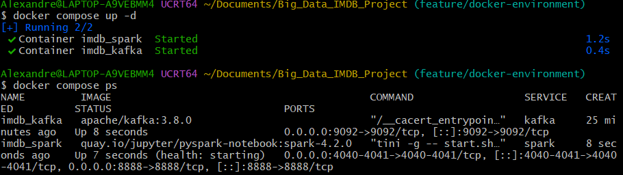
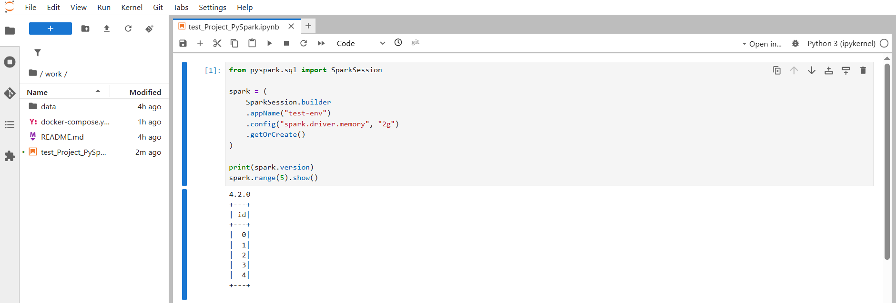

# IMDb Big Data Processing Project

## Contributors

| Name | Email |
|------|-------|
| Alexandre Celles |alexandre.celles@edu.ece.fr |
| Romain Arcis |romain.arcis@edu.ece.fr |

## Prerequisites

The whole project runs inside differents Docker containers which are Apache Spark and Apache Kafka and do not need to be installed on the host machine.

### Software

- Git (https://git-scm.com/downloads) (Git Bash on Windows) to clone the repository
- Docker Desktop (https://docs.docker.com/get-started/get-docker/) with Docker Compose, to run the Spark and Kafka containers
- A web browser to access JupyterLab as Firefox, Chrome or anything else

### Hardware

- At least **8 GB of RAM** because Spark and Kafka are memory-intensive
- At least **20 GB of free disk space** with Docker images (~8 GB), IMDb dataset and its Parquet conversion

### Versions used

All versions are pinned in `docker-compose.yml`, so the environment is identical on every machine.

| Component | Version |
|-----------|---------|
| Apache Spark (PySpark) | 4.2.0 |
| Scala | 2.13 |
| Java (inside the container) | 21 |
| Apache Kafka (KRaft mode, no Zookeeper) | 3.8.0 |
| Spark image | `quay.io/jupyter/pyspark-notebook:spark-4.2.0` |

## Environment Setup

### 1. Clone the repository

```bash
git clone https://github.com/Alexandre-50/Big_Data_IMDB_Project.git
cd Big_Data_IMDB_Project
```

### 2. Start the containers

Make sure Docker Desktop is running, then start the environment:

```bash
docker compose up -d
```

The first run downloads the images (about 8 GB), which can take several minutes.

Check that both containers are running:

```bash
docker compose ps
```

Two containers must appear with the status `Up`:

| Container | Role | Ports |
|-----------|------|-------|
| `imdb_spark` | JupyterLab and PySpark | 8888 (Jupyter), 4040-4041 (Spark UI) |
| `imdb_kafka` | Kafka broker | 9092 |



### 3. Access JupyterLab

Get the access link (with its token) from the container logs:

```bash
docker logs imdb_spark
```

Open the most recent link starting with `http://127.0.0.1:8888/lab?token=...`
in a browser. The repository is mounted in the `work/` folder, so every file
created in Jupyter is directly saved in the repository.

### 4. Check that Spark works

In a new notebook inside `work/`, run:

```python
from pyspark.sql import SparkSession

spark = (
    SparkSession.builder
    .appName("test-env")
    .config("spark.driver.memory", "2g")
    .getOrCreate()
)

print(spark.version)
spark.range(5).show()
```

The output must display `4.2.0` followed by a table with the numbers 0 to 4.



### 5. Stop the environment

```bash
docker compose down
```

## Running the Project

### Data Preparation

To be completed.

### Data Exploration

To be completed.

### Data Enrichment

To be completed.

### Streaming

To be completed.

### Open Question

To be completed.

## AI/LLM Tools Declaration

| Tool | Tasks |
|------|-------|
| Claude (Anthropic) | ... |
| 