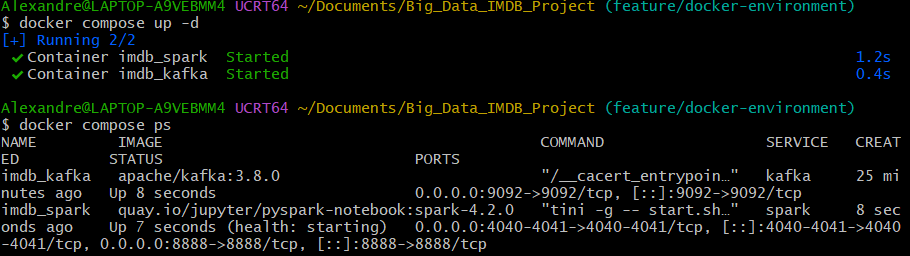
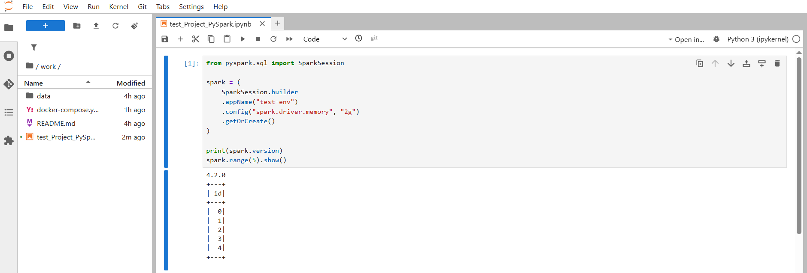

# IMDb Big Data Processing Project

## Contributors

| Name | Email |
|------|-------|
| Alexandre Celles | alexandre.celles@edu.ece.fr |
| Romain Arcis | romain.arcis@edu.ece.fr |

## Prerequisites

The whole project runs inside two Docker containers (Apache Spark and Apache
Kafka), so neither needs to be installed on the host machine.

### Software

- [Git](https://git-scm.com/downloads) (Git Bash on Windows) to clone the repository
- [Docker Desktop](https://docs.docker.com/get-started/get-docker/) with Docker
  Compose, to run the Spark and Kafka containers
- A web browser (Chrome, Firefox...) to access JupyterLab

### Hardware

- At least **8 GB of RAM**, because Spark and Kafka are memory-intensive
- At least **20 GB of free disk space** for the Docker images (~8 GB), the IMDb
  dataset (~2 GB) and its Parquet tables (raw and cleaned)

### Dataset

The [IMDb non-commercial datasets](https://developer.imdb.com/non-commercial-datasets/)
are used for personal and non-commercial purposes only. They are not stored in
this repository and must be downloaded (see Data Preparation). IMDb updates the
files daily; the results in REPORT.md were produced with the files downloaded on
26 October 2026.

### Versions used

All versions are pinned in `docker-compose.yml`, so the environment is identical on every machine.

| Component | Version |
|-----------|---------|
| Apache Spark (PySpark) | 4.2.0 |
| Scala | 2.13 |
| Java (inside the container) | 21 |
| Apache Kafka (KRaft mode, no Zookeeper) | 3.8.0 |
| Spark image | `quay.io/jupyter/pyspark-notebook:spark-4.2.0` |

## Environment Setup

### 1. Clone the repository

```bash
git clone https://github.com/Alexandre-50/Big_Data_IMDB_Project.git
cd Big_Data_IMDB_Project
```

### 2. Start the containers

Make sure Docker Desktop is running, then start the environment:

```bash
docker compose up -d
```

The first run downloads the images (about 8 GB), which can take several minutes.

Check that both containers are running:

```bash
docker compose ps
```

Two containers must appear with the status `Up`:

| Container | Role | Ports |
|-----------|------|-------|
| `imdb_spark` | JupyterLab and PySpark | 8888 (Jupyter), 4040-4041 (Spark UI) |
| `imdb_kafka` | Kafka broker | 9092 |



### 3. Access JupyterLab

Get the access link (with its token) from the container logs:

```bash
docker logs imdb_spark
```

Open the most recent link starting with `http://127.0.0.1:8888/lab?token=...`
in a browser. The repository is mounted in the `work/` folder, so every file
created in Jupyter is directly saved in the repository.

### 4. Check that Spark works

In a new notebook inside `work/`, run:

```python
from pyspark.sql import SparkSession

spark = (
    SparkSession.builder
    .appName("test-env")
    .config("spark.driver.memory", "2g")
    .getOrCreate()
)

print(spark.version)
spark.range(5).show()
```

The output must display `4.2.0` followed by a table with the numbers 0 to 4.



### 5. Stop the environment

```bash
docker compose down
```

### Troubleshooting (Windows, 8 GB machines)

- **`No such file or directory` with `docker exec -w /home/jovyan/work`**: Git
  Bash converts paths that start with `/`. Run `export MSYS_NO_PATHCONV=1` in
  each new Git Bash window.
- **Container name already in use**: an old container named `imdb_spark` or
  `imdb_kafka` exists. List them with `docker ps -a` and remove the old one.
- **`Cannot allocate memory`, Spark freezing or Docker crashing**: give 5 GB to
  WSL by creating `C:\Users\<user>\.wslconfig` with the content below, then run
  `wsl --shutdown` and restart Docker Desktop. Also stop Kafka during batch jobs
  (`docker stop imdb_kafka`) and run Spark on 2 cores with
  `SPARK_MASTER="local[2]"`.

  ```ini
  [wsl2]
  memory=5GB
  processors=4
  swap=4GB
  ```

- **Disk full**: keep at least 10 GB free. Spark writes temporary files during
  large joins and Docker's virtual disk does not shrink automatically.

## Running the Project

### Data Preparation

All commands are run from the repository folder in Git Bash
(`export MSYS_NO_PATHCONV=1` first on Windows).

1. Download the 7 IMDb files into `data/raw/` (about 1.9 GB, do not unzip them):

   ```bash
   mkdir -p data/raw && cd data/raw
   for f in name.basics title.akas title.basics title.crew title.episode title.principals title.ratings; do
     curl -O https://datasets.imdbws.com/$f.tsv.gz
   done
   cd ../..
   ```

2. Run the four preparation scripts in this order (Spark logs go to `spark.log`):

   ```bash
   docker stop imdb_kafka
   for script in ingest_raw null_analysis data_quality clean_data; do
     docker exec -w /home/jovyan/work -e PYTHONPATH=/home/jovyan/work \
       -e SPARK_MASTER="local[2]" imdb_spark \
       spark-submit --driver-memory 2g src/preparation/$script.py 2> spark.log
   done
   ```

| Script | Question | Output |
|--------|----------|--------|
| `ingest_raw.py` | Ingestion | `data/parquet/` (raw tables, all columns as strings) |
| `null_analysis.py` | 1.1 and 1.2 | `results/preparation/missing_values.csv` |
| `data_quality.py` | 1.3 | `results/preparation/data_quality.csv` |
| `clean_data.py` | 1.4 | `data/processed/` (cleaned, typed tables) and `results/preparation/cleaning_summary.csv` |

Every script can be re-run after an interruption: tables or checks that are
already finished are skipped. On an 8 GB laptop the whole preparation takes
several hours, most of it spent on the joins of `title.principals`
(102 million rows). On a machine with more memory, drop
`-e SPARK_MASTER="local[2]"` to use all the cores.

### Data Exploration

To be completed.

### Data Enrichment

To be completed.

### Streaming

The streaming part needs the Parquet tables (see Data Preparation) and both
containers running (`docker start imdb_kafka` if Kafka was stopped). On
Windows Git Bash, run `export MSYS_NO_PATHCONV=1` first.

1. Install the Python dependencies of the producer (once per container):

   ```bash
   docker exec -w /home/jovyan/work imdb_spark pip install -r requirements.txt
   ```

2. Start the producer, which forwards the Wikimedia `recentchange` stream
   to the Kafka topic `wikipedia-changes` (here for 35 minutes, in the
   background):

   ```bash
   docker exec -d -w /home/jovyan/work -e PYTHONPATH=/home/jovyan/work imdb_spark \
     sh -c "python -m src.streaming.wikipedia_producer --duration 2100 > /tmp/producer.log 2>&1"
   ```

3. Run the Spark Structured Streaming pipeline for 30 minutes. The first
   run also builds the IMDb lookup table in `data/processed/streaming_lookup`:

   ```bash
   docker exec -w /home/jovyan/work -e PYTHONPATH=/home/jovyan/work imdb_spark \
     spark-submit --driver-memory 2g \
     --packages org.apache.spark:spark-sql-kafka-0-10_2.13:4.2.0 \
     src/streaming/streaming_pipeline.py --duration 1800
   ```

   Matched events are printed in the console every 30 seconds and saved in
   `results/streaming/` (Parquet), with checkpoints in `checkpoints/streaming/`.
   Delete both folders to start a new test from scratch.

4. Compute the metrics of the run (written to `results/streaming/summary.md`):

   ```bash
   docker exec -w /home/jovyan/work -e PYTHONPATH=/home/jovyan/work imdb_spark \
     spark-submit --driver-memory 2g src/streaming/streaming_report.py
   ```

### Open Question

To be completed.

## AI/LLM Tools Declaration

| Tool | Tasks |
|------|-------|
| Claude (Anthropic) | Git workflow and repository structure, Docker Compose environment and its troubleshooting (memory, disk, Windows paths), setup and run instructions of this file, data preparation code (ingestion, missing value analysis, data quality checks, cleaning), reviewed and tested by us. |
| Claude (Anthropic) | Streaming code (Kafka producer, Spark Structured Streaming pipeline, metrics script) and debugging, reviewed and tested by us. |

AI tools were not used to write the explanations and reasoning of REPORT.md.
