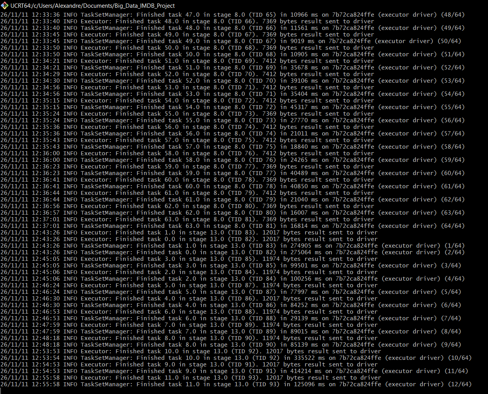

# IMDb Big Data Processing Report

## 1. Data Preparation

### 1.1 Null and Missing Values per Column

| Table | Column | Total rows | Null | Empty | Missing % |
|---|---|---|---|---|---|
| name.basics | nconst | 15765984 | 0 | 0 | 0.0 |
| name.basics | primaryName | 15765984 | 87 | 0 | 0.0 |
| name.basics | birthYear | 15765984 | 15081377 | 0 | 95.66 |
| name.basics | deathYear | 15765984 | 15501152 | 0 | 98.32 |
| name.basics | primaryProfession | 15765984 | 3203725 | 0 | 20.32 |
| name.basics | knownForTitles | 15765984 | 1909359 | 0 | 12.11 |
| title.akas | titleId | 59949689 | 0 | 0 | 0.0 |
| title.akas | ordering | 59949689 | 0 | 0 | 0.0 |
| title.akas | title | 59949689 | 0 | 0 | 0.0 |
| title.akas | region | 59949689 | 12939076 | 0 | 21.58 |
| title.akas | language | 59949689 | 19549363 | 0 | 32.61 |
| title.akas | types | 59949689 | 40116604 | 0 | 66.92 |
| title.akas | attributes | 59949689 | 59633311 | 0 | 99.47 |
| title.akas | isOriginalTitle | 59949689 | 0 | 0 | 0.0 |
| title.basics | tconst | 12898691 | 0 | 0 | 0.0 |
| title.basics | titleType | 12898691 | 0 | 0 | 0.0 |
| title.basics | primaryTitle | 12898691 | 0 | 0 | 0.0 |
| title.basics | originalTitle | 12898691 | 0 | 0 | 0.0 |
| title.basics | isAdult | 12898691 | 0 | 0 | 0.0 |
| title.basics | startYear | 12898691 | 1487504 | 0 | 11.53 |
| title.basics | endYear | 12898691 | 12735133 | 0 | 98.73 |
| title.basics | runtimeMinutes | 12898691 | 8033359 | 0 | 62.28 |
| title.basics | genres | 12898691 | 547433 | 0 | 4.24 |
| title.crew | tconst | 12898691 | 0 | 0 | 0.0 |
| title.crew | directors | 12898691 | 5746998 | 0 | 44.55 |
| title.crew | writers | 12898691 | 6387208 | 0 | 49.52 |
| title.episode | tconst | 9978123 | 0 | 0 | 0.0 |
| title.episode | parentTconst | 9978123 | 0 | 0 | 0.0 |
| title.episode | seasonNumber | 9978123 | 2096402 | 0 | 21.01 |
| title.episode | episodeNumber | 9978123 | 2096402 | 0 | 21.01 |
| title.principals | tconst | 102512651 | 0 | 0 | 0.0 |
| title.principals | ordering | 102512651 | 0 | 0 | 0.0 |
| title.principals | nconst | 102512651 | 0 | 0 | 0.0 |
| title.principals | category | 102512651 | 0 | 0 | 0.0 |
| title.principals | job | 102512651 | 82720617 | 0 | 80.69 |
| title.principals | characters | 102512651 | 52510212 | 0 | 51.22 |
| title.ratings | tconst | 1725891 | 0 | 0 | 0.0 |
| title.ratings | averageRating | 1725891 | 0 | 0 | 0.0 |
| title.ratings | numVotes | 1725891 | 0 | 0 | 0.0 |

We started to download the IMdB dataset with all files as title.ratings, title.principals, title.basics. We download the different files (.tsv.gz) on 26th October 2026 on the website datasets.imdbws.com where frequently IMDb updates them daily, so the figures depend on that date. The files contains 7 tables with 39 columns for a count approximately 215.7 million rows in total.

To obtain the result, we used the IMDb marker `\N` which is converted to null upon reading the file, a value is considered "empty" if it is an empty string or contains only spaces. To calculate the percentage, we used the formula Percentage = (nulls + empty values) / total number of rows × 100.

In the results, we got the percentage of nulls, missing, or empty records. We see that `empty_count` is 0 everywhere because IMDb never uses empty strings, only `\N`. The columns (`tconst`, `nconst`, `titleId`, `ordering`) have a 0% null rate, however, this does not guarantee that they point to existing rows this will be verified in step 1.3. Also, some columns are always populated: `titleType`, `primaryTitle`, `originalTitle`, `isAdult`, `category`, and `isOriginalTitle`.

The table `title.ratings` has a 0% null rate, simply because the file only contains titles that have been rated. The "missing ratings" are evident elsewhere: only 1.73 million titles are rated out of 12.9 million (approximately 13%). The column `primaryName` contains 87 null values, representing individuals without a name. While this is a very small number, it is nonetheless surprising.

Certain columns will have a direct impact on the exploration phase as `runtimeMinutes` (62.28%) for question 2.1, regarding film durations, `startYear` (11.53%) for questions involving years (2.2 and 2.3), `directors` (44.55%) for question 2.4, regarding directors, `genres` (4.24%) for all questions involving genres.

Finally `seasonNumber` and `episodeNumber` have the exact same number of null values ​​(2,096,402). These likely correspond to the same episodes that lack both a season number and an episode number.

`characters` has a null rate of 51.22%: individuals who are not actors (such as directors, composers, etc.) do not have an associated character.

### 1.2 Top Five Columns with the Highest Null Percentage

| Rank | Table | Column | Null % |
|---|---|---|---|
| 1 | title.akas | attributes | 99.47 |
| 2 | title.basics | endYear | 98.73 |
| 3 | name.basics | deathYear | 98.32 |
| 4 | name.basics | birthYear | 95.66 |
| 5 | title.principals | job | 80.69 |

To get the five columns across the entire dataset that have the highest percentage of null values, we needed to understand the question well because it refers exclusively to null values, but since `empty_count` is 0 throughout, the ranking is the same as it would be for missing values.

Then the core idea, is that these nulls do not all carry the same meaning where some represent unknown data, while others correspond to information that is simply not applicable to a given row. 

- The column `attributes` is an optional label for an alternative title (“literal title,” “working title,” etc.), which applies only in rare cases.

- The column `endYear` this one, only concerns series (tvSeries, tvMiniSeries). It is meaningless for a film, and it does not yet exist for an ongoing series. 

- The column `deathYear` which is left blank for living individuals, but also when the date is unknown—and there is no way to distinguish between the two cases.

- The column `birthYear` for this instance, it is a genuine case of missing data, as most of the individuals listed are lesser-known crew members. 

- The column `job` which is a free-text specification of a role, which is often redundant with the `category` field.

Looking ahead to question 1.4, this distinction will guide our processing strategy. An absent `endYear` for a film is not treated the same way as an unknown `birthYear`.

### 1.3 Other Data Quality Issues

After we obtained the different null and missing values, in this step we searched the other issues such as people who died before they were born, foreign keys with missing parent records or some others.
For this, we got 27 checks across the 7 tables, grouped into 5 categories: impossible values, consistency between columns, non-existent references, list formatting, and duplicates. These data correspond to the "unfinished" Parquet tables located in `data/parquet` where all these columns are just text (type string) in Parquet files. We made a Python script `data_quality.py` located in `src/preparation/` with the 27 checks.

- Impossible Values: death before birth, "living" person over 120 years old, future year, duration ≤ 0, season or episode ≤ 0, rating outside the 1–10 range, votes ≤ 0, isAdult value other than 0 or 1.

- Consistency between columns: endYear precedes startYear; endYear appears for a title that is not a series.

- Referential integrity: identifiers that point to a non-existent row, identified using `left_anti` joins (retaining rows from the "child" table that have no corresponding match in the "parent" table).

- List format: comma-separated lists are split using `explode`, and then each element is validated against a regular expression (tt…, nm…, or a genre starting with an uppercase letter).

- Duplicates: use `groupBy` on the key, then keep the keys that have more than one occurrence.

In the script, we converted the numbers with `try_cast` which returns null if the value is not a number, instead of causing Spark 4 to crash. In output, we got the values located in the CSV file `data_quality.csv` where for each check, it includes the number of rows verified, the number of issues found, the percentage, and three example identifiers. The file is written line by line, which allows the script to resume from where it left off in the event of a crash—something we experienced due to memory issues.

Results: 

For the first results, out of 27 checks, only 11 identified issues, while the remaining 16 found none (no duplicates, no invalid formats, no inconsistencies between endYear and startYear, and no invalid ratings).

The primary issues relate to references to non-existent individuals or titles, as well as values that are suspicious yet plausible (e.g., future release dates, "season 0," or individuals of an advanced age). All percentages are below 0.1%.

We got in output the different rows checked: 

| Check | Table | Rows checked | Issues | Issues % |
|---|---|---|---|---|
| Principal with an unknown person | title.principals | 102512651 | 7403 | 0.0072 |
| Season or episode number <= 0 | title.episode | 9978123 | 7108 | 0.0712 |
| Start year in the future | title.basics | 12898691 | 5180 | 0.0402 |
| Alive person older than 120 years | name.basics | 15765984 | 2796 | 0.0177 |
| Writer with an unknown person | title.crew | 15201667 | 1146 | 0.0075 |
| Director with an unknown person | title.crew | 9568274 | 419 | 0.0044 |
| Principal on an unknown title | title.principals | 102512651 | 206 | 0.0002 |
| Death year before birth year | name.basics | 15765984 | 27 | 0.0002 |
| Known-for title that does not exist | name.basics | 25513329 | 10 | < 0.0001 |
| Episode with an unknown parent series | title.episode | 9978123 | 5 | 0.0001 |
| Runtime not numeric or <= 0 | title.basics | 12898691 | 4 | < 0.0001 |

For example, for the Check "Director with an unknown person", "Write" or "Known-for", the count refers to the items in the lists, not the rows in the table, since a single row may mention multiple people or multiple titles.

Based on the table, we can understand that there are actual errors and potential errors because for the first case, we have for example 27 deaths occurring before birth, 4 durations ≤ 0, and broken references (7,403, 1,146, 419, 206, 10, 5—these 5 episodes all originate from the series tt28606619). Indeed, for this the cause is probably about the broken references where IMDb files are exported separately.

For the 2nd case, we got only 5,180 upcoming titles (announcements), 7,108 seasons or episodes numeroted of 0 (special episodes and pilots), 2,796 individuals over 120 years old with no recorded death (death date not provided) which linked with the case deathYear we observed in the question 1.2. 

### 1.4 Handling Strategy

For this part, after found and observed the different issues on the Parquet tables, we used another Python script `clean_data.py` located in `src/preparation` will reads Parquet tables located `data/parquet` to write cleaned tables in Parquet in the path `data/processed`. There are three possible actions as "deleted", "correct" (set to null), or mark (add a Boolean column) to got the final results.
The issues value in this table shows, the treatment chosen for each problem: 

| Issue (1.3) | Count | Handling | Action |
|---|---|---|---|
| Principal with an unknown person | 7403 | rows removed | remove |
| Principal on an unknown title | 206 | rows removed | remove |
| Episode with an unknown parent series | 5 | rows removed | remove |
| Runtime <= 0 | 4 | `runtimeMinutes` set to null | correct |
| Death year before birth year | 27 | both years set to null, `has_invalid_life_dates = true` | correct and flag |
| Start year in the future | 5180 | kept, `is_upcoming = true` | flag |
| Alive person older than 120 years | 2796 | kept, `death_year_unknown = true` | flag |
| Season or episode number <= 0 | 7108 | kept (specials and pilots) | none |
| Director / writer with an unknown person | 419 / 1146 | kept in the lists, dropped by inner joins later | none |
| Known-for title that does not exist | 10 | kept in the list, dropped by inner joins later | none |
| Not applicable nulls (e.g. `endYear` of a movie) | - | kept | none |

At the output, for example years, duration, ordering, and votes become integers, the rating becomes a decimal number. the variable isAdult and isOriginalTitle become booleans or genres, primaryProfession, knownForTitles, directors, and writers become arrays (split by comma).

After this, in output, the script cleans the values and the CSV file contains only the number of rows before and after for each table `cleaning_summary.csv` in `results/preparation`. 
We got the new table with the comparison of the number of rows before and after cleaning:

| Table | Rows before | Rows after | Rows removed |
|---|---|---|---|
| name.basics | 15765984 | 15765984 | 0 |
| title.basics | 12898691 | 12898691 | 0 |
| title.ratings | 1725891 | 1725891 | 0 |
| title.episode | 9978123 | 9978118 | 5 |
| title.principals | 102512651 | 102505042 | 7609 |
| title.crew | 12898691 | 12898691 | 0 |
| title.akas | 59949689 | 59949689 | 0 |

In the table, we got at the column Rows removed 7609, the result from 7403 + 206 which corresponds to the numbers got in the previous question (1.3) with no row contained both an unknown person and an unknown title. The 5 deleted episodes belong to the unknown series tt28606619, only 2 out of 7 tables lost any rows, and in each case, it was less than 0.01% of their total rows. Finally, we have the other issues were either corrected or flagged without deleting any rows.

### Methodological Explanation

For the question 1.1 to the part 2 (Data Exploration), to ingest the different values on the tables, the Python script `ingest_raw.py` located in `src/preparation/` reads the 7 `.tsv.gz` files using Spark (sep="\t", nullValue="\N", quote="") and writes them out once in Parquet format to `data/parquet` where the number of rows is verified after the write operation and also tables that already have a `_SUCCESS` marker are skipped if the script is run again. We used this method because as we know Parquet is columnar and compressed, where a script that reads only 2 columns does not read the entire file, and subsequent reads are much faster than with compressed TSV (since gzip files cannot be split, Spark processes each file using a single task).
As alternative solution, we also could reread the TSV for every script which is simple but it changes the process time.

To the question 1.2, we used the Python script from the path `src/preparation/null_analysis.py` which reads the Parquet tables from `data/parquet`, where for each table we have just one aggregation which calculate, for all columns simultaneously firstly the number of nulls (isNull)—that is, the `\N` values ​​converted during ingestion and secondly the number of empty or whitespace-only strings (`trim(column) == ""`). We obtain in output the file `missing_values.csv` from `results/preparation`. 
We used this method because we want to have a single pass per table—7 passes in total for the 39 columns, With tables containing over 100 million rows and each pass is costly. Counting empty strings also makes it possible to verify that IMDb uses only `\N` for missing values, rather than simply assuming so. The result `empty_count = 0` confirms this. The other advantage is that at the question 1.2 we do not trigguer any new Spark computations because it reuses just the result from the previous question.
For this as alternative solution, we could use just a request per column which is moresimple to write and read but with 39 readings contrary to 7 is much slower.

For the question 1.3, we chose the method explained previously such as `left_anti` join for broken references because this is a direct way to keep only those rows that have no corresponding match in the other table. We used the Spark function `try_cast` because we wanted to check that if a value is not a number, it becomes `null` instead of causing the job to fail—which, in fact, makes it possible to count such instances. For the Spark treatment, we got a line entry written after each check because Spark crashed due to the fact that the computer only has 8 GB of RAM, which is not enough for these volumes. This ensures that only the current check is lost, and the script can resume from where it left off. 
Alternatively, we could used a standard join followed by a function`isNull` which filter yields the same result as a `left_anti` join, but it retains the columns from both tables and consumes more memory.

For the question 1.4, we used `left_semi` via the method `.join` to retain only those rows where the title or the person exists, also `when`to set impossible values ​​to `null`, adding new Boolean columns as markers and writing each table as soon as it is ready, accompanied by a `_SUCCESS` marker. 

We used this method to handle different things because we want to remove only what would break the joins, we keep plausible values ​​because they are real and the flagging columns allow each question in Part 2 (Data Exploration) to decide whether or not to filter. Alternatively, we also could have chosen not to perform any cleaning or filtering within each script but the same task would be repeated everywhere, with a risk of something being overlooked.

## 2. Data Exploration

In this section and for all of the questions (2.1 through 2.8), we used the data corresponding to the various cleaned tables located in the `data/processed folder`. 

### 2.1 Feature-Length Movies with Atypical Runtime per Genre

For this question, We were looking for feature films whose running times differ significantly from those of other films in the same genre. To do this, we defined two key criteria: first, what constitutes a feature film, and second, what does “significantly different” mean?.To do this, we used the cleaned tables from Question (1.4), where durations ≤ 0 are already set to null, and the columns are typed, to retain only the `title.basics` column, which contains only the type, duration, and genres.
We defined a feature film as having `titleType==“movie”`, which allowed us to exclude TV series episodes, short films, and TV movies. We also defined the official definition from the Academy and the AFI named as `runtimeMinutes` >= 40 with a specified genre. To clearly distinguish the genres of feature films, we've categorized them using the `genres` column, which is nothing more than a simple table. For example, [Drama, Romance, Sci-Fi]. We also used the `explode` function so that each movie appears as a separate row by genre, allowing it to be compared with other movies in each of those genres. We also calculated statistics by genre, where for each genre we have: the number of films, the mean, the standard deviation, and the Q1, median, and Q3 quartiles. The quartiles are calculated using `percentile_approx`, which is an approximate but fast method.

Initially, to establish a threshold for success, we used the z-score, whereby a film is considered atypical if its runtime is more than 2 standard deviations from the genre average. Ultimately, we abandoned this idea because runtime does not follow a normal distribution: a few extremely long films inflate the mean and standard deviation, making the threshold too broad. The Documentary genre is a perfect example of this, with a standard deviation of 224 minutes. Subsequently, we chose the IQR with Tukey’s rangebounds: 
- lower rangebound = Q1 − 1.5 × IQR 
- upper rangebound = Q3 + 1.5 × IQR 
- a film outside these rangebounds is considered outlier (much shorter or much longer).

We saved the results in two different CSV files. The first file, `q2_1_runtime_by_genre.csv`, contains one row per genre (the table), and the second, `q2_1_atypical_runtime_movies.csv`, contains a list of all atypical movies, along with their genres and runtimes. These two CSV files are located in the `results/exploration folder`.

The results we obtained: 

| Genre | Movies | Mean | Std | Q1 | Median | Q3 | Low fence | High fence | Much shorter | Much longer | Atypical % | Z-score atypical |
|---|---|---|---|---|---|---|---|---|---|---|---|---|
| Drama | 196359 | 96.0 | 37.1 | 81 | 93 | 107 | 42.0 | 146.0 | 27 | 7675 | 3.92 | 1966 |
| Documentary | 115814 | 78.0 | 223.8 | 57 | 74 | 90 | 7.5 | 139.5 | 0 | 2067 | 1.78 | 58 |
| Comedy | 96445 | 93.1 | 28.7 | 82 | 91 | 102 | 52.0 | 132.0 | 2627 | 4616 | 7.51 | 1614 |
| Romance | 42398 | 99.1 | 25.1 | 85 | 95 | 110 | 47.5 | 147.5 | 187 | 1994 | 5.14 | 2041 |
| Action | 40288 | 101.2 | 33.8 | 85 | 94 | 113 | 43.0 | 155.0 | 7 | 1879 | 4.68 | 838 |
| Crime | 34544 | 95.5 | 26.3 | 83 | 92 | 105 | 50.0 | 138.0 | 338 | 1752 | 6.05 | 1077 |
| Thriller | 33992 | 96.1 | 21.8 | 85 | 93 | 105 | 55.0 | 135.0 | 793 | 1728 | 7.42 | 2087 |
| Horror | 30650 | 88.6 | 22.3 | 79 | 88 | 96 | 53.5 | 121.5 | 1102 | 1323 | 7.91 | 706 |
| Adventure | 24028 | 93.0 | 30.6 | 79 | 90 | 101 | 46.0 | 134.0 | 154 | 1311 | 6.1 | 632 |
| Mystery | 16454 | 94.3 | 50.4 | 81 | 92 | 105 | 45.0 | 141.0 | 3 | 492 | 3.01 | 52 |
| Biography | 16083 | 89.2 | 29.4 | 69 | 88 | 104 | 16.5 | 156.5 | 0 | 325 | 2.02 | 454 |
| Family | 15922 | 92.3 | 32.7 | 77 | 90 | 102 | 39.5 | 139.5 | 0 | 883 | 5.55 | 281 |
| Music | 13933 | 88.4 | 57.7 | 68 | 87 | 100 | 20.0 | 148.0 | 0 | 385 | 2.76 | 97 |
| History | 13611 | 94.3 | 52.9 | 72 | 90 | 108 | 18.0 | 162.0 | 0 | 419 | 3.08 | 143 |
| Fantasy | 12693 | 94.0 | 31.9 | 80 | 91 | 104 | 44.0 | 140.0 | 3 | 514 | 4.07 | 241 |
| Sci-Fi | 9806 | 91.2 | 30.5 | 79 | 90 | 100 | 47.5 | 131.5 | 174 | 418 | 6.04 | 147 |
| Musical | 8479 | 100.0 | 33.3 | 82 | 94 | 111 | 38.5 | 154.5 | 0 | 487 | 5.74 | 238 |
| Animation | 8314 | 82.6 | 26.8 | 68 | 81 | 93 | 30.5 | 130.5 | 0 | 221 | 2.66 | 175 |
| War | 8040 | 94.8 | 31.3 | 80 | 92 | 105 | 42.5 | 142.5 | 1 | 358 | 4.47 | 217 |
| Sport | 6795 | 88.9 | 37.4 | 71 | 90 | 100 | 27.5 | 143.5 | 0 | 185 | 2.72 | 99 |
| Western | 6372 | 76.5 | 28.7 | 57 | 70 | 90 | 7.5 | 139.5 | 0 | 133 | 2.09 | 151 |
| Adult | 6116 | 79.3 | 26.2 | 66 | 77 | 85 | 37.5 | 113.5 | 0 | 351 | 5.74 | 172 |
| News | 1409 | 77.6 | 32.2 | 60 | 75 | 88 | 18.0 | 130.0 | 0 | 28 | 1.99 | 27 |
| Film-Noir | 876 | 81.9 | 13.8 | 71 | 82 | 91 | 41.0 | 121.0 | 0 | 3 | 0.34 | 31 |
| Reality-TV | 299 | 91.8 | 84.8 | 64 | 90 | 96 | 16.0 | 144.0 | 0 | 12 | 4.01 | 2 |
| Talk-Show | 104 | 87.6 | 33.6 | 60 | 79 | 112 | -18.0 | 190.0 | 0 | 0 | 0.0 | 5 |
| Game-Show | 8 | 80.5 | 32.8 | 52 | 67 | 87 | -0.5 | 139.5 | 0 | 1 | 12.5 | 1 |

In the table, we found 27 genres and 34,976 atypical cases using the IQR, compared with 13,552 using the z-score.
Of the 34,976 cases, 29,560 are much longer and only 5,416 are much shorter. The atypical cases are mostly films that are too long. We also note that there are few films considered “too short” because we have already excluded films shorter than 40 minutes. In several genres, the lower bound is below 40 (Documentary 7.5, Western 7.5, Biography 16.5…), so no film can fall below these values: 0 films that are significantly shorter. The most “consistent” genres are Comedy, Horror, and Thriller: their ranges are narrow (Horror from 53.5 to 121.5), so they have the most outliers (7.5% to 7.9%).
Documentary has a huge standard deviation (223.8 minutes, with an average of 78): a few extremely long documentaries pull the average and standard deviation upward. Finally, using the z-score, only 58 documentaries would be considered outliers, compared to 2,067 using the IQR. This example illustrates why the IQR is more reliable than the z-score.

### 2.2 Top Three Genres per Year (1980-2025)

For this question, we used the same data as in the previous question—specifically, the cleaned tables from `data/processed`, where `titleType` = “movie,” the runtime is at least 40 minutes, and a genre is specified—and then ran `explode` to get one row per movie and per genre with the Python script `genre_popularity.py`. A movie categorized as “Action, Comedy” therefore counts toward both genres. We filtered the years, keeping only those from 1980 to 2025 using `startYear`, and performed a join to retrieve the number of votes and the rating from `title.ratings`. 
The next step was to identify and define the popularity of a genre for each year. To do this, we calculated the sum of the IMDb votes for its movies in that year, as well as the number of movies and the average rating. Finally, we generated the ranking using a window function `(row_number on Window.partitionBy(“year”)`, sorted by votes in descending order, which gives the rank of each genre within its respective year and retained ranks 1 through 3 for section 2.2. We got the results in the CSV file `q2_2_top3_genres_per_year.csv`. 

The results we obtained for (Top Three Genres per Year (1980-2025))

| Year | 1st | 2nd | 3rd |
|---|---|---|---|
| 1980 | Drama (3 158 183) | Adventure (2 479 450) | Horror (2 066 777) |
| 1981 | Adventure (2 248 413) | Drama (1 707 446) | Horror (1 271 524) |
| 1982 | Drama (3 069 760) | Sci-Fi (2 453 194) | Action (1 870 739) |
| 1983 | Drama (2 916 145) | Action (2 022 445) | Adventure (1 982 463) |
| 1984 | Action (3 663 165) | Drama (3 020 035) | Adventure (2 928 747) |
| 1985 | Comedy (4 558 233) | Adventure (3 405 170) | Drama (3 073 399) |
| 1986 | Drama (3 993 586) | Adventure (2 964 192) | Comedy (2 781 998) |
| 1987 | Drama (4 129 304) | Comedy (3 681 969) | Action (2 357 978) |
| 1988 | Drama (4 458 584) | Comedy (4 424 141) | Action (2 710 677) |
| 1989 | Comedy (5 005 932) | Drama (3 956 067) | Adventure (2 940 268) |
| 1990 | Drama (6 313 984) | Comedy (4 011 189) | Crime (3 584 428) |
| 1991 | Drama (5 578 356) | Crime (3 668 792) | Comedy (3 190 631) |
| 1992 | Drama (6 089 842) | Comedy (4 068 657) | Crime (3 606 074) |
| 1993 | Drama (8 984 860) | Comedy (4 493 167) | Crime (3 041 228) |
| 1994 | Drama (15 723 757) | Crime (6 498 278) | Comedy (5 666 084) |
| 1995 | Drama (12 509 025) | Crime (7 754 505) | Comedy (6 073 697) |
| 1996 | Drama (7 851 601) | Comedy (4 704 644) | Crime (4 438 618) |
| 1997 | Drama (12 614 512) | Action (6 760 085) | Comedy (5 600 120) |
| 1998 | Drama (11 770 955) | Comedy (9 851 715) | Crime (6 213 252) |
| 1999 | Drama (15 502 154) | Comedy (8 213 814) | Crime (7 173 533) |
| 2000 | Drama (13 010 489) | Comedy (8 326 678) | Adventure (6 984 635) |
| 2001 | Drama (14 722 244) | Comedy (9 504 503) | Adventure (9 242 706) |
| 2002 | Drama (17 044 023) | Adventure (8 683 291) | Action (8 386 051) |
| 2003 | Drama (13 241 538) | Action (11 698 251) | Comedy (10 748 199) |
| 2004 | Drama (16 460 608) | Action (11 506 130) | Comedy (10 935 650) |
| 2005 | Drama (13 677 206) | Comedy (10 182 452) | Action (9 046 990) |
| 2006 | Drama (20 866 485) | Comedy (11 762 176) | Thriller (8 656 534) |
| 2007 | Drama (18 519 249) | Comedy (11 702 310) | Action (8 987 301) |
| 2008 | Drama (17 562 246) | Action (13 396 901) | Comedy (11 318 224) |
| 2009 | Drama (17 573 356) | Comedy (13 448 604) | Action (12 107 286) |
| 2010 | Drama (17 539 923) | Action (13 323 674) | Adventure (13 166 751) |
| 2011 | Drama (20 728 301) | Action (17 132 119) | Comedy (13 968 980) |
| 2012 | Drama (20 098 999) | Action (14 478 412) | Comedy (11 716 369) |
| 2013 | Drama (21 963 352) | Action (17 146 747) | Comedy (14 788 799) |
| 2014 | Drama (24 493 597) | Action (20 914 674) | Adventure (17 717 858) |
| 2015 | Drama (20 467 537) | Action (15 543 016) | Adventure (14 147 079) |
| 2016 | Drama (20 859 050) | Action (17 184 660) | Adventure (12 349 595) |
| 2017 | Drama (20 759 650) | Action (16 686 958) | Comedy (11 288 317) |
| 2018 | Drama (17 383 695) | Action (15 056 616) | Adventure (13 326 927) |
| 2019 | Drama (21 985 693) | Action (12 337 608) | Comedy (12 242 622) |
| 2020 | Drama (10 461 822) | Comedy (6 504 091) | Action (6 120 264) |
| 2021 | Drama (14 369 528) | Action (12 847 670) | Adventure (10 169 776) |
| 2022 | Drama (15 947 607) | Action (13 327 925) | Comedy (10 192 458) |
| 2023 | Drama (14 722 211) | Action (10 568 397) | Comedy (9 471 129) |
| 2024 | Drama (11 638 274) | Action (8 633 407) | Comedy (7 081 709) |
| 2025 | Drama (8 531 990) | Action (7 636 595) | Comedy (5 852 900) |

The results table shows that certain feature film genres dominate more than others. For example, the Drama genre dominates, it has been in the top 3 for all 46 years and ranked first 42 times. The genre Drama was not in first place only four times, all of which occurred in the 1980s: 1981 (Adventure), 1984 (Action), 1985, and 1989 (Comedy).
The top three genres vary by decade:
- 1980s: a wide variety (Adventure, Horror, Sci-Fi, Action, Comedy)
- 1990s: mainly Drama, Comedy, and Crime
- 2000–2007: Drama, Comedy, followed by Action or Adventure
- since 2008: mainly Drama and Action, followed by Comedy or Adventure.
- 2020 : Decline (10.5 million for *Drama*, compared to 22 million in 2019) due to the COVID-19 pandemic, with far fewer theatrical releases.

Finally, we observed that the number of votes increased through the 2010s (from fewer than 3.2 million for the top genre in 1980 to 24.5 million in 2014), then declined in recent years (8.5 million in 2025). The most likely explanation is that recent films have had less time to accumulate votes.

### 2.3 Top Three Genres Compared to the Others

For this question, we used the same tables and Python script `genre_popularity.py` as the previous question (2.2) with feature films from 1980 to 2025, with one film counted only in each of its genres, popularity equal to the sum of the votes; and the ranking for each genre by year. To do this, we analyzed two groups per year: the top 3 (ranks 1 through 3) and the other genres (rank 4 and beyond).
For each group and each year, we calculate the following:
- the share of votes, which is the number of votes for the group divided by the total number of votes across all genres 
- the share of films, which is the number of films in the group divided by the total number of films across all genres 
- the votes per film, which is the number of votes for the group divided by the number of films in the group 
- the average rating, weighted by the number of films in each genre (a genre with 1,000 films carries more weight than a genre with 10 films) 
- the number of other genres that year

We calculate the frequency by genre, across all years which represents how many years it has been in the top 3 and how many years it has been number one.
The output of the `genre_popularity.py` script was saved in two separate CSV files: the first is `q2_3_top3_vs_rest.csv`, which contains one row per year, and the second is `q2_3_top3_frequency.csv`, which contains one row per genre. 

1st table The genres that made it into the top 3 (over 46 years): 

| Genre | Years in top 3 | Years ranked 1st |
|---|---|---|
| Drama | 46 | 42 |
| Comedy | 34 | 2 |
| Action | 29 | 1 |
| Adventure | 16 | 1 |
| Crime | 9 | 0 |
| Horror | 2 | 0 |
| Sci-Fi | 1 | 0 |
| Thriller | 1 | 0 |

2nd table Top 3 compared to other genres, on average per period:

| Period | Years | Top 3 vote share % | Top 3 movie share % | Votes per movie, top 3 | Votes per movie, others | Avg rating, top 3 | Avg rating, others |
|---|---|---|---|---|---|---|---|
| 1980s | 10 | 46.2 | 43.6 | 5155 | 4734 | 6.02 | 5.94 |
| 1990s | 10 | 47.2 | 50.3 | 9763 | 10975 | 6.02 | 5.98 |
| 2000s | 10 | 42.0 | 46.0 | 11067 | 12974 | 6.02 | 6.17 |
| 2010s | 10 | 44.0 | 37.0 | 8724 | 6464 | 6.08 | 6.22 |
| 2020-2025 | 6 | 44.1 | 39.8 | 4802 | 3885 | 6.05 | 6.13 |
| All years | 46 | 44.8 | 43.6 | 8172 | 8147 | 6.04 | 6.08 |

This 2nd table corresponds to the average of the annual values for each period.
In the table shows a variety of results, and we can already see that only 8 genres have made it into the top 3 over the course of just 46 years. The genres Drama, Comedy, and Action together account for 109 of the 138 spots (46 + 34 + 29), while Horror, Sci-Fi, and Thriller have only appeared in the top 3 once or twice. We also note that the top 3 genres account for an average of 44.8% of the votes (ranging from 38.3% to 58.2% depending on the year), we can conclude that these three genres carry nearly as much weight as all the others combined. The top three genres are therefore popular mainly because of the large number of films they represent. This is supported by two observations: firstly, the share of films in the top 3 (43.6%) is almost the same as their share of the votes (44.8%), secondly, on average, a film in the top 3 receives about as many votes as a film in other genres (8,172 versus 8,147). Their popularity is mainly due to the number of films, not because each film is watched significantly more often. We also noted a clear break starting in 2002 in fact, from 1980 to 2001 the top 3 genres received higher ratings than the others 17 out of 22 years, but starting in 2002, they received lower ratings every year (24 out of 24). For example, in the 2010s, the score was 6.08 compared to 6.22.

### 2.4 Directors with One Hit and Several Low-Rated Movies

For this question, we used the other cleaned table as `title.ratings`, `title.basics`, `title.crew` and `name.basics` located in `data/processed` with the Python script `director_ratings.py`. For this, we limited the data to movies, with `titleType = “movie”`, excluding TV series and TV movies. We used a minimum of 100 votes per movie, specified in the script as `MIN_VOTES = 100`, so that a rating given by only three people would not be counted as a win. To manage the relationship between a director and a film, we used the “directors” column in `title.crew`, which is a list; by applying the `explode` function, we obtain one row for each (director, film) pair, as well as a join with `title.basics` and `title.ratings`.
To group the different directors, we used the PySpark method `groupBy` on `nconst` to calculate the number of hits where the rated movies have a score of ≥ 8.0, the number of other movies rated < 8.0, and also the average rating of those other movies. Once this was done, we include directors who have exactly one hit, at least two other films, and an average rating of 6.0 or lower for other movies. For each hit, we added the director’s name from the `name.basics` table and information about the film (title, year, rating, votes, etc.), sorted by the number of votes for that film. The list of directors is located in the CSV file `q2_4_one_hit_directors.csv` in the path `results/exploration/`.

List of the 15 most-voted-for hits:

| Director | Hit movie | Year | Hit rating | Hit votes | Other movies | Other movies avg rating |
|---|---|---|---|---|---|---|
| James McTeigue | V for Vendetta | 2005 | 8.1 | 1259640 | 4 | 5.98 |
| Richard Marquand | Star Wars: Episode VI - Return of the Jedi | 1983 | 8.3 | 1227917 | 6 | 5.98 |
| M. Night Shyamalan | The Sixth Sense | 1999 | 8.2 | 1173007 | 15 | 5.87 |
| Richard Kelly | Donnie Darko | 2001 | 8.0 | 923855 | 3 | 5.43 |
| Robert Rodriguez | Sin City | 2005 | 8.0 | 825235 | 23 | 5.9 |
| Frank Miller | Sin City | 2005 | 8.0 | 825235 | 2 | 5.65 |
| Martin Campbell | Casino Royale | 2006 | 8.0 | 757358 | 20 | 5.62 |
| John G. Avildsen | Rocky | 1976 | 8.1 | 705406 | 21 | 5.78 |
| Curtis Hanson | L.A. Confidential | 1997 | 8.2 | 665857 | 15 | 6.0 |
| Tate Taylor | The Help | 2011 | 8.1 | 534511 | 6 | 5.88 |
| Kirk Wise | Beauty and the Beast | 1991 | 8.0 | 510929 | 3 | 5.43 |
| Garth Davis | Lion | 2016 | 8.0 | 269950 | 2 | 5.65 |
| Wai Keung Lau | Infernal Affairs | 2002 | 8.0 | 139751 | 43 | 5.72 |
| Vincent Paronnaud | Persepolis | 2007 | 8.0 | 107379 | 4 | 5.83 |
| Billy Bob Thornton | Sling Blade | 1996 | 8.0 | 105093 | 3 | 5.93 |

Initially, we identified 188 directors, but given the length of the list, we kept the top 15 to get a general idea.
In terms of the number of other films, the median is 4; 59 directors have the minimum—that is, 2 other films. The maximum is Wai Keung Lau (Infernal Affairs) with 43 other films. We observe that the average rating for these other films is 5.35 out of 10, with the lowest being 2.83. At the top of the list, we find well-known titles such as: *V for Vendetta*, *Return of the Jedi* (Richard Marquand, not George Lucas), *The Sixth Sense* (Shyamalan), *Donnie Darko*, *Rocky*, and *Casino Royale*. We also note the distribution over time, with the majority of hits being recent (51 in the 2020s, 45 in the 2010s, 43 in the 2000s); this trend probably aligns with the increase in the number of films and IMDb users.

### 2.5 TV Series with Worst Episode in the Last Season

For this question, we used the same cleaned tables as `title.ratings`, `title.basics` and `title.episode` with the Python script `series_episode_ratings.py` located in `src/exploration`. For the question, we keep only the series with `titleType` noted as `tvSeries` and `tvMiniSeries` in the script. To filter the relevant episodes, we included only seasons with a season number greater than or equal to 1 (`seasonNumber ≥ 1`), since season 0 (special episodes and pilots, included in Question 1.4) and episodes without a season number are excluded, as they are not part of a “regular” season. To determine which series qualify, we count the episodes in each season (using `groupBy` on the series and season); we define a season as “long” if it has at least 10 episodes; we keep the series with at least 3 long seasons; and finally, the last season is the highest season number in the series. Once this step is complete, to determine the best and worst episode of each series, we performed a join with the `title.ratings` table—so only rated episodes can be the best or worst—and used a window function (`row_number` partitioned by series) that sorts episodes by rating; in the event of a tie, the episode with the most votes wins. In the end, we have the final filter with the worst episode in the last season and the best episode in season 1 or 2, along with the series title, its overall rating, and the number of votes, with the results sorted by the number of votes for each series.
In the output, the list of series with at least three seasons of 10 or more episodes, in which the worst episode aired during the last season and the best episode is included in the first two seasons, is included in the CSV file `q2_5_series_worst_episode_last_season.csv`. 

List of the 15 Most-Voted-For Series:

| Series | Start | Seasons | Best episode (season, episode, rating) | Worst episode (season, episode, rating) | Series rating | Series votes |
|---|---|---|---|---|---|---|
| House of Cards | 2013 | 6 | S2 E1 (9.5) | S6 E8 (2.5) | 8.6 | 564849 |
| Narcos | 2015 | 3 | S2 E10 (9.4) | S3 E1 (7.8) | 8.7 | 538817 |
| The Flash | 2014 | 9 | S1 E15 (9.6) | S9 E6 (3.8) | 7.4 | 389683 |
| You | 2018 | 5 | S2 E9 (9.1) | S5 E10 (5.3) | 7.6 | 378033 |
| 13 Reasons Why | 2017 | 4 | S1 E13 (9.1) | S4 E4 (5.1) | 7.4 | 344438 |
| The Umbrella Academy | 2019 | 4 | S2 E10 (8.9) | S4 E6 (4.8) | 7.8 | 319272 |
| Two and a Half Men | 2003 | 12 | S2 E23 (8.7) | S12 E15 (3.7) | 7.1 | 301804 |
| True Blood | 2008 | 7 | S2 E8 (8.8) | S7 E10 (5.4) | 7.9 | 273929 |
| Heroes | 2006 | 4 | S1 E20 (8.9) | S4 E15 (6.8) | 7.5 | 267394 |
| Jessica Jones | 2015 | 3 | S1 E9 (9.0) | S3 E2 (7.1) | 7.8 | 242943 |
| Demon Slayer: Kimetsu no Yaiba | 2019 | 4 | S2 E17 (9.8) | S4 E4 (7.1) | 8.5 | 240127 |
| One Punch Man | 2015 | 3 | S1 E12 (9.5) | S3 E6 (1.6) | 8.6 | 232040 |
| 24 | 2001 | 8 | S1 E24 (9.3) | S8 E9 (7.6) | 8.4 | 208709 |
| Silicon Valley | 2014 | 6 | S1 E8 (9.3) | S6 E4 (7.3) | 8.5 | 185083 |
| The Originals | 2013 | 5 | S1 E22 (9.5) | S5 E9 (8.0) | 8.2 | 163540 |

Initially, we identified 562 series that meet the conditions, but given the length of the list, we kept the top 15 to get a general idea.
Across the 562 series, the best episode is in Season 1 for 282 series, and in Season 2 for 280. We observe a gap between the best and worst episodes, with a median of 2.4 points and an average of 2.6; at the median, the best episode is rated 8.6 and the worst is rated 6.1. There are a few particularly striking cases, notably for the series *House of Cards*, where the rating dropped from 9.5 (S2E1) to 2.5 (S6E8). The final season was filmed without the lead actor, Kevin Spacey, following his dismissal from the series. The very low rating of 2.5 could certainly be linked to his absence. Another example is the series *The Flash*, which went from a rating of 9.6 to 3.8 over the course of nine seasons. But we also have shows that are highly rated overall and are on the list as well, such as *Narcos* (8.7), *House of Cards* (8.6), and *Demon Slayer* (8.5). We can conclude, then, that a show can still be good overall even if it ends with its worst episode in the last season.

### 2.6 Actors Successful in Multiple Languages

For this question, we used the cleaned tables as `title.basics` is used for the type (movie) and the original title, `title.ratings` for the rating and number of votes, to determine a film's success, `title.akas` for alternative titles, to guess the language, `title.principals` for the actors and actresses in each film, and `name.basics` for the actors' names. With the Python script `actor_languages.py`, a movie is considered a hit if its rating is ≥ 7.0 with at least 10,000 votes (well-rated and viewed by many people) and `titleType = “movie”` in the script. The original language is inferred from `title.akas` because IMDb does not have an “original language” column. It searches for alternative titles that match the original title after removing capital letters, spaces, and punctuation each title found “votes” for a language: its “language” column if it is filled in, otherwise the country (region), translated into the language using a lookup table (FR → fr, JP → ja…), and the language that receives the most votes wins. For example, the Netherlands receives only a low vote (0.1) because it often retains the original titles of foreign films. For actors, we performed a join on successful films whose language is known and where `category` equals `actor` or `actress` in `title.principals`. For each actor, we have the number of distinct languages via `countDistinct`, the list of those languages, and the number of successful films; for both lists, we require at least 2 languages and subsequently 3 languages. The output consists of the various lists in separate CSV files, such as `q2_6_actors_2plus_languages.csv`, `q2_6_actors_3plus_languages.csv`, `q2_6_successful_movie_languages.csv` to have the predicted language for each movie, `q2_6_language_coverage.csv` to determine the origin of the language, and `q2_6_top_languages.csv` to identify the most frequent languages.

What is the language origin of these 4,953 successful movies?

| Language source | Movies |
|---|---|
| `language` column of title.akas | 4237 |
| Region translated to a language | 509 |
| Unknown (movie ignored) | 207 |

List of the most common languages in success movies:

| Language | Movies |
|---|---|
| en | 3941 |
| fr | 250 |
| de | 132 |
| es | 124 |
| it | 66 |
| da | 37 |
| sv | 33 |
| ko | 31 |
| ja | 22 |

List of actors with at least 3 languages (the top 15 out of 185):

| Actor / actress | Languages | Language list | Successful movies |
|---|---|---|---|
| Toshirō Mifune | 6 | de, en, fr, it, ja, sv | 7 |
| Şener Şen | 5 | de, en, fr, ja, tr | 15 |
| Song Kang-ho | 5 | en, es, fr, it, ko | 11 |
| Tony Leung Chiu-wai | 5 | de, en, es, fr, ko | 10 |
| Takeshi Kaneshiro | 5 | ca, de, fr, yue, zh | 5 |
| Max von Sydow | 4 | da, en, fr, sv | 17 |
| Gérard Depardieu | 4 | en, es, fr, it | 12 |
| Cem Yılmaz | 4 | de, en, ja, tr | 8 |
| Thomas Kretschmann | 4 | da, de, en, ko | 8 |
| Bibi Andersson | 4 | da, en, fr, sv | 7 |
| Christian Berkel | 4 | da, de, en, yue | 7 |
| Liv Ullmann | 4 | da, en, fr, sv | 7 |
| Maggie Cheung | 4 | en, es, ko, yue | 7 |
| Tatsuya Nakadai | 4 | de, en, fr, sv | 7 |
| Trine Dyrholm | 4 | da, de, en, fr | 7 |

Well-known examples with at least 2 languages:

| Actor / actress | Languages | Language list | Successful movies |
|---|---|---|---|
| Penélope Cruz | 3 | en, es, it | 12 |
| Marion Cotillard | 2 | en, fr | 12 |
| Juliette Binoche | 2 | en, fr | 11 |
| Javier Bardem | 2 | en, es | 13 |
| Daniel Brühl | 2 | de, en | 10 |
| Mads Mikkelsen | 2 | da, en | 17 |

Looking at our results as a whole, we see that among the 4,953 successful films, the language is identified for 4,746 of them (95.8%); 4,237 were identified using the “language” column, and 509 others were identified based on the country, but 207 films remain unknown and are excluded. There are 1,226 actors or actresses who have been successful in at least 2 languages, and 185 in at least 3. Among all successful films, English is the dominant language in 3,941 out of 4,746 films (approximately 83%), partly because IMDb is predominantly English-speaking and 10,000 votes favor American films but inflated by errors, such as the French movie *The Intouchables* being listed under English. The top of the ranking for 3 or more languages is the least reliable: Japanese, Turkish, or Korean actors are listed with European languages (de, fr, sv) that likely stem from misattributed alternative titles.

### 2.7 Actors Whose Popularity Peaked Early

For this question, we used the cleaned tables in `data/processed`, `title.basics`, `title.ratings`, `title.principals` and `name.basics` with the Python script `actor_careers.py`. The table `title.principals` is to find out who starred in which film, where the actor → film link is established with the `category` set to `actor` or `actress`. The table `title.basics` is to determine the type and year of each film using, for example, `titleType = "movie"` and `startYear`, which are essential for measuring the length of an actor's career in years. The table `title.ratings` is to display the rating and number of votes for each movie, where the rating is used to measure popularity, and the votes are filtered to show only those with at least 100 votes and finally the table `name.basics` was used to retrieve the actors' names through `primaryName`, instead of displaying only their identifiers (`nm...`). To determine eligibility, we considered the actor's career length, with at least a 20-year span between the first and last films, and a minimum of 15 films.

For roles, we retained only the `category` criterion—which is set to `actor` or `actress` in the `title.principals` table using a broadcast join on the retained films. We used the PySpark `dropDuplicates` method to avoid counting an actor twice if they have two roles in the same film. For each actor’s career, we used window functions (`Window.partitionBy(“nconst”)`) to calculate various metrics, such as:
- first year = the year of their first film,
- last year = the year of their last film,
- number of films. 

We divided each actor’s career into three equal-length thirds (beginning, middle, and end). For example, a career spanning 1970 to 2030 results in 1970–1990 (beginning), 1990–2010 (middle), and 2010–2030 (end). Each film is assigned to the third in which it falls.

This step allows us to determine whether popularity peaked at the beginning of a career if two conditions are met:  
- the highest-rated film is in the first third (in the event of a tie, the film with the most votes wins),
- the average rating for the first third is higher than that of the last third.

After running the script, we obtained our various results in two separate CSV files:
- `q2_7_early_peak_actors.csv`, which contains a list sorted by the largest drop in rating (average at the beginning minus average at the end), 
- `q2_7_summary.csv`, which tallies the number of different actors and actresses

List of the number of actors after each filter: 

| Step | Actors / actresses |
|---|---|
| Eligible (20+ years, 15+ movies) | 10707 |
| Best rated movie in the first third of the career | 5052 |
| … and first-third average higher than last-third average (early peak) | 4200 |

In the table, we had 10,707 actors and actresses who have at least 20 years in the industry and have appeared in at least 15 films. These are the only ones the question allows us to study. 5,052 of these are actors and actresses whose highest-rated film falls within the first third of their career (the first condition). Finally, 4,200 are actors whose popularity peaked early and whose average ratings for the first third of their careers are also higher than those for the last third (the second condition).

List of the 12 well-known actors selected from the final list of 4,200:

| Actor / actress | Career | Movies | Best movie (year, rating) | Avg first third | Avg last third | Drop |
|---|---|---|---|---|---|---|
| Shelley Duvall | 1970-2023 | 20 | The Shining (1980, 8.4) | 7.18 | 3.5 | 3.68 |
| Bruce Willis | 1987-2023 | 101 | Pulp Fiction (1994, 8.8) | 6.45 | 4.51 | 1.95 |
| Al Pacino | 1971-2025 | 57 | The Godfather (1972, 9.2) | 7.31 | 5.83 | 1.48 |
| Linda Blair | 1973-2021 | 29 | The Exorcist (1973, 8.1) | 4.96 | 3.65 | 1.31 |
| Alain Delon | 1957-2019 | 79 | Rocco and His Brothers (1960, 8.2) | 6.6 | 5.48 | 1.13 |
| Kirk Douglas | 1946-2004 | 72 | Paths of Glory (1957, 8.4) | 6.95 | 5.9 | 1.05 |
| Gérard Depardieu | 1971-2022 | 168 | Jean de Florette (1986, 8.1) | 6.47 | 5.5 | 0.97 |
| Orson Welles | 1937-1987 | 67 | Citizen Kane (1941, 8.2) | 6.99 | 6.19 | 0.79 |
| Harrison Ford | 1967-2025 | 51 | The Empire Strikes Back (1980, 8.7) | 7.22 | 6.63 | 0.59 |
| Robert De Niro | 1968-2026 | 100 | The Godfather Part II (1974, 9.0) | 6.67 | 6.15 | 0.51 |
| Mark Hamill | 1977-2025 | 45 | The Empire Strikes Back (1980, 8.7) | 6.14 | 6.08 | 0.06 |
| Clint Eastwood | 1955-2021 | 53 | The Good, the Bad and the Ugly (1966, 8.8) | 6.93 | 6.9 | 0.03 |

The complete list of 4,200 actors is in the file `q2_7_early_peak_actors.csv` in `results/exploration` directory. The table shows that 10,707 actors and actresses have had careers spanning at least 20 years with at least 15 films; of these, 47% of actors have their highest-rated film in the first third of their career, and 39% of those who are eligible also meet the second condition. The `Drop` column shows the size of the gap between the average ratings at the start of a career and those at the end, and indicates how much the average rating has decreased for each of the 4,200 actors who meet both conditions (best film at the start, and a higher average at the start than at the end). But by how much is the average higher, depending on the actor? We can see, for example, that Shelley Duvall’s and Bruce Willis’s careers have dropped significantly (3.68) and (1.95), respectively, and also that for actors Clint Eastwood (0.03) and Mark Hamill (0.06), where the beginning and end are almost at the same level, it’s clear that they’re on the list because their best film is from a long time ago, and probably not because their careers have collapsed.

### 2.8 Multi-Talented Professionals

For this question, we used the cleaned tables in `data/processed`, `title.basics`, `title.ratings`, `title.principals`,`name.basics` and `title_crew` with the Python script `multi_talented_professionals.py`. The table `title.basics` is to to include only the title type, to include only movies (`titleType = “movie”`), `title.ratings` to view the rating for each film (to compare “multi” and “single” films) and the number of votes (filter for at least 100 votes). `title.principals` to have the actors and actresses in each film (`category` equals `actor` or `actress`), as well as some of the directors and screenwriters, `title_crew` to have the directors (directors list) and screenwriters (writers list) for each film and `name.basics` to retrieve the person’s name (primaryName), rather than just their nm identifier…
As with the other cases, we used at least 100 votes, keeping only movies by filtering by `titleType = “movie”`. 

For the three roles we extracted from two tables:
- actor, which corresponds to a “category” value of ‘actor’ or “actress” in `title.principals`, 
- director: the `directors` list in `title.crew` (using `explode`), plus “category” = “director” in `title.principals`, 
- screenwriter: the `writers` list in `title.crew` (using `explode`), plus “category” = “writer” in `title.principals`.

For these three roles, we used the PySpark unionByName method to combine the three role sources. For all roles in a given film (using collect_set), we retrieve one row per (person, film) pair, containing all the roles held by that person in the film. For example, for the film Pulp Fiction and Tarantino, this gives us [actor, director, writer]. We defined the term “multi-talent” as a person who has held at least 2 of the 3 roles during their career, each in at least 2 films; this ensures that a single appearance (a cameo, for example) is not sufficient.

Thus, for each film by a multi-talent, we examine the film type:
- multi: the person played multiple roles in it,
- single: the person played only one role in it.

We also perform a paired comparison: for each person who has both types of films, we compare the average of their “multi” films to the average of their “single” films; thus, each person is compared to themselves.
Finally, for role combinations (actor+director, director+writer, etc.), we considered the number of films, the number of people, the average rating, and the average number of votes. In output, we received our results in three different CSV files, which are:
- `q2_8_multi_talented_people.csv` , with one row per person, 
- `q2_8_summary.csv` for the overall summary,
- `q2_8_by_combination.csv` for the results by combination.

Performance of multi-talented people (single-role vs multi-role movies):

| Metric | Value |
|---|---|
| Multi-talented people | 20932 |
| … with both single-role and multi-role movies | 13930 |
| Average rating, single-role movies | 5.797 |
| Average rating, multi-role movies | 5.818 |
| Average difference (multi - single) | 0.021 |
| Median difference | 0.032 |
| People rated better in multi-role movies | 51.2 % |

The complete list (20,932 people) is in `results/exploration/q2_8_multi_talented_people.csv`.

In this table, we got different informations as (Multi-talented people) who have held at least 2 of the 3 roles (actor, director, screenwriter) in their careers, each in at least 2 films. (with both single-role and multi-role movies) which refers to people who have both types of films: films in which they play multiple roles (multi) and films in which they play only one role (single). We can only compare these people because the other 7,000 have only one type of film. (Average rating, single-role), which corresponds to the average rating of their films in which they play only one role (for example, only as actresses). (Average rating, multi-role), which corresponds to the average rating of their films in which they play multiple roles (for example, as both directors and actresses in the same film). (Average difference), where, for each person, we calculate multi-role average minus single-role average, then take the average of these differences: +0.02 points, which is nearly zero. (Median difference), which is the median of these differences—close to +0.03—and confirms that the average is not skewed by a few extreme cases. (People rated better in multi-role movies), which is the percentage of people who receive a higher rating when they hold multiple roles: 51%, or roughly one in two.

Average rating per combination of roles held on the same movie:

| Roles on the movie | Person-movie rows | People | Avg rating | Avg votes |
|---|---|---|---|---|
| actor | 62995 | 6679 | 5.86 | 21346 |
| director+writer | 59946 | 17034 | 5.96 | 10282 |
| director | 28090 | 8039 | 5.94 | 14227 |
| writer | 27595 | 7860 | 5.92 | 23440 |
| actor+director+writer | 6422 | 3429 | 5.6 | 6396 |
| actor+writer | 5632 | 2790 | 5.62 | 12793 |
| actor+director | 1568 | 987 | 5.71 | 11211 |

List of Known Examples:

| Person | Career roles | Movies | Multi-role movies | Avg multi | Avg single | Difference |
|---|---|---|---|---|---|---|
| Quentin Tarantino | actor+director+writer | 21 | 15 | 7.71 | 6.68 | 1.02 |
| Charles Chaplin | actor+director+writer | 20 | 17 | 7.55 | 6.53 | 1.02 |
| Woody Allen | actor+director+writer | 62 | 54 | 6.89 | 5.69 | 1.2 |
| Mel Gibson | actor+director+writer | 63 | 5 | 7.42 | 6.18 | 1.24 |
| Ben Affleck | actor+director+writer | 52 | 8 | 7.25 | 6.13 | 1.12 |
| Orson Welles | actor+director+writer | 82 | 25 | 6.9 | 6.34 | 0.55 |
| Clint Eastwood | actor+director | 69 | 25 | 6.91 | 6.83 | 0.08 |
| Jon Favreau | actor+director+writer | 39 | 5 | 6.62 | 6.58 | 0.04 |
| M. Night Shyamalan | actor+director+writer | 18 | 16 | 6.01 | 6.15 | -0.14 |
| Spike Lee | actor+director+writer | 36 | 19 | 6.43 | 6.92 | -0.5 |
| Tyler Perry | actor+director+writer | 46 | 39 | 5.27 | 6.43 | -1.16 |

Looking at the various tables, we can see that among so-called “multi-talented” individuals, the most common combination is director+writer, by a wide margin (14,372 people), followed by actor+director+writer (3,013), actor+writer (2,679), and actor+director (868), for a total of 20 932 people. These figures correspond to the career profiles of these people, while the 17,034 people in the previous table correspond to those who have been both director and writer on at least one same film, including those whose career profile also includes actor. The director-screenwriter duo is also very common, with many directors writing their own films. This raises the question: do they perform better when they take on multiple roles?
We see that, on average, there is almost no difference; in fact, the score is 5.82 for “multi” films versus 5.80 for “single” films, a difference of +0.02 (median +0.03). 51.2% of people receive higher ratings when they take on multiple roles—that’s almost a one-in-two chance. Thus, taking on multiple roles does not generally improve the rating. 
However, the figures obtained depend on the specific combination. In fact, the director+writer duo is the highest-rated combination (5.96), so directing one’s own screenplay tends to work quite well. Combinations involving “actor” receive the lowest ratings: actor+writer (5.62), actor+director+writer (5.60), and actor+director (5.71). Acting in a film that one directs or writes is associated with lower ratings. This is not a proven cause, as many small, low-budget independent films fall into this category.

### Methodological Explanation

For the question 2.1, we chose the IQR because Quartiles are not influenced by outliers, whereas the mean and standard deviation are. Running times do not follow a normal distribution (skewed toward longer films). Also we chose the time 40 minutes because this is official definition of a feature film and 1.5 because this is Tukey’s standard value, we could have used 3 to include only the extreme cases. Alternatively, we could have used a fixed percentage (the top 5% by runtime); we would still end up with the same number of films, even in a very consistent genre.

For the question 2.2, we chose this method, first of all, because the total number of votes effectively measures viewership—the more a genre is watched, the more votes it receives. Also, because the question asks for the most popular genres, not the highest-rated ones. Finally, we used the same criteria as in Question 2.1 (movie, at least 40 minutes) to maintain consistency. Alternatively, we could have considered only the number of films, which reflects production volume, rather than audience interest. A genre with many small, little-seen films would come out on top.

For the question 2.3, we took several indicators into account, such as (share of votes, share of movies, votes per movie, rating), because a single one isn’t enough; in fact, the share of votes alone doesn’t tell us whether a genre is popular because it has a lot of movies or because its movies are widely watched. We chose to use the average rating weighted by the number of films; otherwise, a small genre with only 10 films would carry as much weight as the Drama genre, which has thousands of films. Alternatively, we could have tried to calculate an unweighted average score (a simple average of the genres) that would surely have been simpler—but the smaller genres would have carried the same weight as the larger ones.

For the question 2.4, we chose the thresholds of 8.0 and 6.0 because they come directly from the question, at least 2 movies because this is the minimum meaning of “several.” We took a minimum of 100 votes because without it, movies rated by just a handful of people (such as people close to the production team, for example) would be just considered “hits.” We took just movies because the question refers to movies, and TV series or TV movies have different audiences. Alternatively, we could have set a higher vote threshold (such as 1,000 or 10,000); we would certainly get more reliable results, but we would exclude many lesser-known or non-English-speaking filmmakers.

For the question 2.5, we excluded Season 0 because it contains special episodes and pilot episodes, which do not constitute a “season” of the series. In fact, if we included it, Season 0 could never be the last, but it could contain the best or worst episode. We included at least 3 seasons with 10 or more episodes because we wanted series that were long enough to show development and avoid short series. Finally, we chose a window function because it finds the best and worst episodes of all the series in a single calculation, without a loop.
Alternatively, we could have compared the average rating of the last season to that of the first few seasons, rather than just a single episode that would have been a more robust comparison, since a single episode can be subject to review bombing, but that wouldn't exactly answer the question.

For the question 2.6, we chose this method because for example for a “Success” with a rating of ≥ 7.0 and at least 10,000 votes, this corresponds to a high rating on its own, which may come from a small audience, and a large number of votes alone may indicate an unpopular movie, the two together mean “well-rated by many people.” In the IMDb dataset, we infer the language from `title.akas` because this is the only language information available. We compared the titles after normalization (without capital letters, spaces, or punctuation) because, for example, the Japanese title “Shichi-nin no samurai” and “Shichinin no samurai” are the same title written differently. Finally, we used “broadcast” because the list of hit movies is small (about 5,000 movies), Spark sends the entire list to each task instead of redistributing the 60 million rows of `title.akas`.
Alternatively, we could use an external source (the TMDb or Wikidata API, which provide the actual original language) which is much more reliable, but this is external data enrichment, subject to API and time constraints.

For the question 2.7, we chose all of these methods specifically because popularity is already measured by the rating—since that is the example given in the question (“highest-rated movies”). We divided the data into three equal-length periods in terms of years, rather than three groups with the same number of films, because the term “early in their career” refers to a period of time; in fact, an actor who makes 10 films in 2 years at the start of their career does not necessarily have a long “early career.” We used two conditions instead of one because the best film on its own could be a one-off fluke; comparing the averages confirms that the overall level has indeed declined. 
Alternatively, we could have measured popularity based on the number of votes rather than the rating—that would have been closer to the concept of popularity—but recent movies have an advantage (more IMDb users), while older movies are at a disadvantage. We could also have used machine learning techniques, such as a linear regression algorithm to analyze how ratings change over time (a negative slope would indicate a decline); this would have been more statistically precise, but it measures a general trend rather than a peak at the beginning.

For the question 2.8, we used two tables `title.crew`, which lists directors and screenwriters, and `title.principals`, which lists actors. We sought to combine them to obtain a comprehensive overview of each film. We required at least two films per role to exclude roles that appeared only once (a brief appearance, a single screenwriting credit) so that it wouldn’t give the impression that a person has multiple talents. We also performed a paired comparison (each person compared to themselves) because we wanted to compare the average rating of their “multi” films to the average rating of their “single” films. This allows us to reduce the influence of each person’s individual talent and measure the effect of taking on multiple roles. We also used the median to check that the average was not influenced by a few extreme cases.
Alternatively, we could have tried to compare all “multi-talent” movies to all “single-talent” movies (unpaired), which would have been simpler, but the result would have conflated the quality of the individuals with the cumulative effect. Finally, the idea of weighting by the number of votes could work because highly-viewed movies would count more, but a few blockbusters would dominate the result.

## 3. Data Enrichment

### Results

Scope: for every genre and year from 1980 to 2025, the 10 most voted
feature films (movie, at least 40 minutes). Sources: Wikidata (IMDb ID
property P345) to find the English Wikipedia article, then Wikipedia for
the texts. Collected on 14 November 2026. Coverage table:
`results/enrichment/coverage.csv`, readable sample (Drama and Sci-Fi,
2010, top 3): `results/enrichment/sample_enriched.json`.

| Metric | Value |
|---|---|
| Slots (genre, year, rank) | 10 198 |
| Distinct films | 7 185 |
| Distinct principals kept | 10 948 |
| Median synopsis length | 593 words |

Synopsis coverage (distinct films):

| Status | Films | % |
|---|---|---|
| Plot section of the Wikipedia article | 5 986 | 83.31 |
| Introduction only (article without a Plot section) | 380 | 5.29 |
| No Wikidata item for the IMDb id | 490 | 6.82 |
| Wikidata item but no English article | 328 | 4.57 |
| Article without text | 1 | 0.01 |

Biography coverage (principals kept):

| Status | People | % |
|---|---|---|
| Biography (introduction of the Wikipedia article) | 8 943 | 81.69 |
| No Wikidata item for the IMDb id | 1 404 | 12.82 |
| Wikidata item but no English article | 600 | 5.48 |
| Article without text | 1 | 0.01 |

Films by number of principals with a biography (up to 6 candidates per
film, the first 3 with a biography are kept):

| Principals with a biography | Films | % |
|---|---|---|
| 3 | 6 101 | 84.91 |
| 2 | 376 | 5.23 |
| 1 | 377 | 5.25 |
| 0 | 331 | 4.61 |

Fields of an enriched record: genre, year, rank in genre, IMDb id,
title, rating, votes, `synopsis`, `synopsis_status`, `synopsis_words`,
`synopsis_lineage` (source URL, Wikipedia title, Wikidata item, retrieval
time, extraction method), and `principals`: array of (billing rank, IMDb
id, name, category, `biography`, `biography_status`,
`biography_lineage`).

### Methodological Explanation

**Film selection.** In this project, a film counts as a full movie when it is an IMDb title of type movie and lasts at least 40 minutes. This is the same rule we used in Section 2.1, and it follows the definition of the Academy and the AFI. For each genre and each year, we keep the 10 films with the most votes, like we did in Section 2.2. We chose to rank films by number of votes and not by rating, and this was on purpose. A film rated 9 out of 10 by only 50 people is usually unknown, and very often it does not even have a Wikipedia page. The number of votes is a better way to see how many people have really watched a film. Because a film can have several genres, it is counted once in each of its genres. This is why our selection has 10,198 slots but only 7,185 different films.

**Finding the right Wikipedia page.** If we search Wikipedia only with the title of a film, it often fails, because many titles are ambiguous. Good examples are "Heat", "Crash", or any film that has a remake. To solve this problem, we use Wikidata. Wikidata has a property called P345 that stores the IMDb identifier of a film. The Wikidata item that has this identifier links directly to the English Wikipedia article of the film. This gives us an exact link, and we never have to guess. We also thought about searching with the title and the release year together, but we decided not to do it because it is less reliable.

**Only texts written by humans.** We only use Wikidata to find the link to the right article, and all the texts in our dataset come from Wikipedia, which is written by real people. So our dataset does not contain any text generated by a machine. The synopsis of each film comes from the "Plot" section of its Wikipedia article. When a film has no Plot section, we use the introduction of the article instead, and we mark it as lead_section. The biographies of people come from the introduction of their own Wikipedia article.

**Ethics and rate limits.** We wanted to be respectful of the Wikimedia servers. Every request we send has a clear User Agent that explains who we are and gives the address of our project. We send the requests one after the other, with a short pause between each one. We also use the maxlag parameter with a value of 5, and we follow the Retry After header. During the collection, Wikidata did send us the HTTP error 429, which means too many requests, and our script waited for the time that the server asked. Our script can also restart where it stopped: when we run it again, it skips all the identifiers that were already collected.

**Collection outside Spark, cleaning inside Spark.** We collect the data with simple Python code, because Wikimedia asks to send the requests one after the other with pauses. If we used Spark for this, many workers would send requests at the same time, which would go against the rate limits. All the other steps are done in Spark, as the assignment asks. In Spark, we extract the Plot section with regular expressions, we remove the small headings and the extra spaces, we give a status to each record, we join the data with the IMDb tables, and we build the nested array of principals.

**Missing data is always visible.** We never hide missing information. Each record has a status that explains what happened: no_wikidata_item, no_english_article, lead_section or no_text. In total, 83% of the films have a Plot section and 5% only have an introduction. The other 11% have no English article at all: 7% have no Wikidata item, and 5% have a Wikidata item but no English Wikipedia article.

**At least three principals.** For each film, we look at up to six people in the order of the credits, and we keep the first three who have a biography. Thanks to this rule, 85% of the films have three principals. If we had only looked at the first three people in the credits, we would have reached only 74%. We also remove duplicates when the same person appears twice in the credits. For example, Natalie Portman is credited both as an actress and as a producer on Black Swan, but we keep her only once.

**Lineage.** Every text keeps its source URL, its Wikidata item, the date when we collected it and the method we used to extract it. This way, it is always possible to find where each value comes from.

**Generic code.** The time period, the size of the top list and the number of candidates are options that we give on the command line. Thanks to this, the same code can process the full dataset without any change.

**Limitations.** Recent films and films that are not in English have less chance of having an English Wikipedia article. Also, Wikipedia pages change over time, so our results depend on the day we collected the data, which was 14 November 2026.

## 4. Streaming

### Streaming Metrics

Test run: 10 November 2026, 16:33 to 17:03 UTC (30 minutes), on an 8 GB
laptop. Window: 5 minutes, watermark: 2 minutes, trigger: 30 seconds.
Full output: `results/streaming/summary.md`.

| Metric | Value |
|---|---|
| Events read from Kafka | 60 970 |
| Events in closed windows | 53 991 |
| English Wikipedia article edits (closed windows) | 2 360 |
| Edits matched with IMDb | 137 |
| Matched on a title / on a person | 90 / 47 |
| Distinct IMDb entities | 94 |
| IMDb lookup table | 58 542 titles, 226 714 people |

| Query | Batches | Input rows | Avg inputRowsPerSecond | Avg processedRowsPerSecond | Rows dropped by watermark |
|---|---|---|---|---|---|
| matched_events | 61 | 60 970 | 33.7 | 303.2 | 0 |
| title_windows | 61 | 60 970 | 33.8 | 273.8 | 0 |
| stream_windows | 61 | 60 955 | 33.8 | 313.3 | 0 |

Arrival delay of the matched edits (Kafka time minus edit time):

| Median | p95 | p99 | Max | Edits later than 2 min |
|---|---|---|---|---|
| 3 s | 9 s | 15 s | 20 s | 0 |

Top 10 most edited IMDb entities:

| IMDb id | Type | Label | Edits | Editors |
|---|---|---|---|---|
| nm0909144 | person | David Walliams | 6 | 3 |
| tt0054545 | title | Hazel | 4 | 1 |
| tt0388629 | title | One Piece | 4 | 3 |
| tt0070842 | title | Turkish Delight | 4 | 1 |
| nm2908492 | person | Grant Harvey | 3 | 1 |
| nm0001001 | person | James Caan | 3 | 2 |
| tt32641461 | title | Mid-Century Modern | 3 | 2 |
| nm1104787 | person | Mutya Buena | 3 | 2 |
| tt0162866 | title | The Emperor and the Assassin | 3 | 1 |
| tt0113613 | title | The Last Supper | 3 | 1 |

### Late Arriving Data

We use event time and not processing time. This means that the time of an event is the timestamp sent by Wikipedia, which is the moment when the edit was made, and not the moment when the event arrives in Spark. Because of this, if an event is late because of the network or because of a reconnection, it is still counted in the window where it really belongs.

We group the events in windows of 5 minutes, with a watermark of 2 minutes. The watermark is equal to the latest event time seen by Spark minus 2 minutes. Spark keeps a window open until the watermark goes past the end of this window. At that moment, the window is closed, it is written to the output, and its state is removed from memory. Any event that is older than the watermark is thrown away.

We chose the value of 2 minutes based on real measurements. We measured the delay between the moment of the edit and the moment the event arrived in Kafka. The median delay was 3 seconds, the 95th percentile was 9 seconds, the 99th percentile was 15 seconds, and the maximum was 20 seconds. No event was dropped during our test, since numRowsDroppedByWatermark was equal to 0. So two minutes gives us a large safety margin compared to the delays we observed.

This choice is a compromise. With a longer watermark, the results would be more complete, but they would be published later and Spark would need to keep more data in memory. With a shorter watermark, the results would come faster, but we would lose more late events, for example the events that the producer sends again when it reconnects with the Last Event ID.

We write the results in append mode. This means that each window is written only one time, when it is final, and it is never changed after that. As an extra protection, the raw table called matched_events has no watermark, so it keeps every event, even the late ones.

### Methodological Explanation

**Architecture.** The data starts from Wikimedia EventStreams, which uses Server Sent Events. A Python producer reads these events and sends them to a Kafka topic. Then Spark Structured Streaming reads the events from Kafka. Kafka separates the source from Spark, which has two big advantages: we can replay the topic, and if Spark restarts, it continues from its checkpoint without losing any data.

**Filtering.** We only keep events from English Wikipedia, in the article namespace, which is namespace 0, and only events of type edit and new. In the closed windows, this left 2,360 article edits out of about 54,000 events.

**Matching with IMDb.** We first normalise the article titles. We remove the disambiguation part at the end of the title and we put all the text in lower case, so "Inception (film)" becomes simply "inception". Then we join the stream with a static IMDb lookup table. This table is broadcast to all the tasks, so the join does not need any shuffle.

**Lookup table.** The table contains 58,542 titles that have at least 1,000 votes, and 226,714 people. These people are actors, actresses, directors or writers who are known for a title with more than 50,000 votes. When two entries have the same name, we keep the one with the most votes. We also remove titles that are only numbers, because a title like "1917" would also match articles about years.

**Iterations.** Our first version had 1.66 million people in the table, and this created a lot of false matches. So we made the table smaller, and we added a rule about the end of the title. For example, "Gemini (language model)" and "Mike Myers (basketball)" are rejected, but endings like "(film)" or "(actor)" are accepted.

**Robustness.** We use checkpoints, longer Kafka timeouts and automatic restarts. We added these settings because a Kafka timeout stopped our first test after only 14 minutes.

**Results.** During a test of 30 minutes, we got 137 matches for 94 different entities. The input rate was about 34 events per second, and the processing rate was about 270 to 315 rows per second.

**Limitations and alternatives.** Some false matches are still there, such as "Turkish delight", which is a sweet and not a film, or names like "Andy" or "Jim Jones". We could improve this by comparing the titles with the exact case of the letters, or by using Wikidata like in the Enrichment part, to get an exact link between Wikipedia articles and IMDb identifiers.

## 5. Open Question

### Question and Motivation

**Question:** has the share of popular films led by an actress grown
between 1980 and 2025, in which genres, and are actress-led films rated
and voted differently from actor-led films?

The place of women on screen is a topic that people discuss a lot, from the #MeToo movement in 2017 to the many studies about representation in cinema. We wanted to check if IMDb data shows a real change over time in how often films have an actress in the main role, and if these films are received differently by the public.

This question is also interesting from a data point of view. IMDb does not have a column for gender, but we can guess it thanks to the categories actor and actress in the table title.principals.

### Results

Scope: 38 297 feature films (movie, at least 40 minutes, 1980-2025, at
least 1 000 votes) with a credited lead. Lead = performer (actor or
actress) with the smallest billing order in `title.principals`. Full
tables: `results/open_question/`.

Share of actress-led films, every five years:

| Year | Films | Actress-led % | Actresses in top-3 cast % | Avg rating, actress-led | Avg rating, actor-led | Median votes, actress-led | Median votes, actor-led |
|---|---|---|---|---|---|---|---|
| 1980 | 287 | 22.3 | 35.2 | 6.01 | 6.32 | 2 652 | 3 781 |
| 1985 | 314 | 21.3 | 32.5 | 6.38 | 6.27 | 3 277 | 4 354 |
| 1990 | 364 | 20.3 | 33.2 | 6.19 | 6.16 | 3 366 | 4 618 |
| 1995 | 429 | 27.7 | 34.8 | 6.21 | 6.32 | 5 518 | 5 377 |
| 2000 | 578 | 31.0 | 37.8 | 6.21 | 6.27 | 4 118 | 4 833 |
| 2005 | 843 | 27.6 | 37.4 | 6.07 | 6.17 | 3 739 | 4 261 |
| 2010 | 1 054 | 27.7 | 35.5 | 5.99 | 6.15 | 3 771 | 3 757 |
| 2015 | 1 383 | 31.0 | 38.1 | 5.93 | 5.99 | 3 187 | 3 512 |
| 2020 | 1 238 | 38.7 | 41.2 | 5.70 | 5.85 | 3 975 | 3 188 |
| 2025 | 1 308 | 32.9 | 37.7 | 6.05 | 6.17 | 2 865 | 2 997 |

Highest yearly share: 38.7 % (2020). Lowest: 18.9 % (1989).

Share of actress-led films per genre (genres with at least 500 films):

| Genre | Films | Actress-led % | 1980s % | 2020s % | Change (points) |
|---|---|---|---|---|---|
| Horror | 5 434 | 44.7 | 32.2 | 52.2 | +20.0 |
| Mystery | 3 427 | 39.9 | 27.8 | 48.7 | +20.9 |
| Romance | 6 332 | 39.3 | 32.4 | 46.0 | +13.6 |
| Animation | 1 508 | 35.6 | 25.2 | 39.2 | +14.0 |
| Fantasy | 2 196 | 32.5 | 22.6 | 42.7 | +20.1 |
| Drama | 21 734 | 32.0 | 25.7 | 36.7 | +11.0 |
| Music | 1 012 | 31.4 | 24.8 | 34.2 | +9.4 |
| Family | 1 554 | 31.3 | 27.0 | 36.2 | +9.2 |
| Thriller | 6 641 | 31.1 | 28.2 | 36.0 | +7.8 |
| Comedy | 13 597 | 27.2 | 19.1 | 35.5 | +16.4 |
| Biography | 1 848 | 27.2 | 29.9 | 30.3 | +0.4 |
| Sci-Fi | 1 878 | 27.1 | 16.2 | 40.9 | +24.7 |
| Documentary | 714 | 26.8 | 29.4 | 30.7 | +1.3 |
| History | 1 337 | 24.0 | 21.8 | 27.2 | +5.4 |
| Adventure | 4 090 | 23.8 | 16.3 | 31.3 | +15.0 |
| War | 682 | 21.4 | 15.2 | 25.0 | +9.8 |
| Crime | 6 297 | 20.1 | 14.4 | 26.7 | +12.3 |
| Action | 7 767 | 16.6 | 10.0 | 21.6 | +11.6 |
| Sport | 692 | 14.0 | 8.6 | 19.5 | +10.9 |

Rating gap (actress-led minus actor-led average rating) and votes ratio
(geometric mean votes, actress-led / actor-led), computed inside each
(genre, decade) group with at least 30 films of each kind, then weighted
by the number of films:

| Decade | Film-genre rows | Groups | Weighted rating gap | Weighted votes ratio |
|---|---|---|---|---|
| 1980s | 7 377 | 14 | -0.178 | 0.734 |
| 1990s | 10 012 | 15 | -0.111 | 0.766 |
| 2000s | 19 013 | 18 | -0.167 | 0.896 |
| 2010s | 31 883 | 20 | -0.147 | 0.922 |
| 2020s | 19 530 | 18 | -0.214 | 1.076 |
| All | 87 815 | 85 | -0.165 | 0.917 |

### Key Takeaways

- **A clear progression.** In 1980, only 22% of films had an actress in the main role. In the 2020s, this share is between 33% and 39%, with a peak of 38.7% in 2020. This increase happened in two steps: a first rise from 20% in 1990 to 31% in 2000, then a plateau between 28% and 31% until 2016, and a second rise up to 38.7% in 2020, at the time of the #MeToo movement.
- **Big differences between genres.** Horror and Mystery are the genres with the most films led by an actress, with 52% for Horror in the 2020s. On the other side, Action with 22% and Sport with 20% are still mostly led by men.
- **The biggest increase is in Science Fiction.** The share of films led by an actress went from 16% to 41%, which is a gain of 25 points. In comparison, Biography and Documentary have almost not changed.
- **Ratings.** When we compare films of the same genre and the same decade, the films led by an actress get a rating that is 0.17 points lower out of 10. The difference is small, but it is the same in every decade.
- **Votes.** Films led by an actress get about 8% fewer votes on average, but this difference is getting smaller. The ratio went from 0.73 in the 1980s to 1.08 in the 2020s, which means that today these films actually get a little more votes.

### Methodological Explanation

**Scope.** We study films that last at least 40 minutes, that were released between 1980 and 2025, and that have at least 1,000 votes. This gives us 38,297 films. We use the limit of 1,000 votes to focus on films that the public really watches, and to avoid ratings given by only a few people.

**Main role.** The main role is the actor or actress with the smallest ordering value. We also compute a second measure: the share of actresses among the first three people in the cast. This way, our results do not depend on only one person.

**Composition bias.** This is the most important point of our analysis. If we simply compared the averages, we would mix all the genres together. For example, horror films get lower ratings and are also more often led by an actress, so this would make films led by an actress look worse in general. To avoid this problem, we compute the difference inside each pair of genre and decade. We only keep the groups that have at least 30 films of each type, and then we compute the average weighted by the number of films.

**Votes.** For the votes, we use the geometric mean, which is the mean of the logarithms. We do this because the number of votes is very unbalanced: a few blockbusters have several million votes, while most films have much fewer.

**Limitations.** Our analysis has some limits. First, gender is guessed from the IMDb category, so it is only binary. Second, the ordering in IMDb does not always follow the official billing order of the film. Third, IMDb ratings can be affected by review bombing campaigns, where many people give bad ratings on purpose. Finally, our results show correlations and not causes, so we cannot say that one thing causes the other.