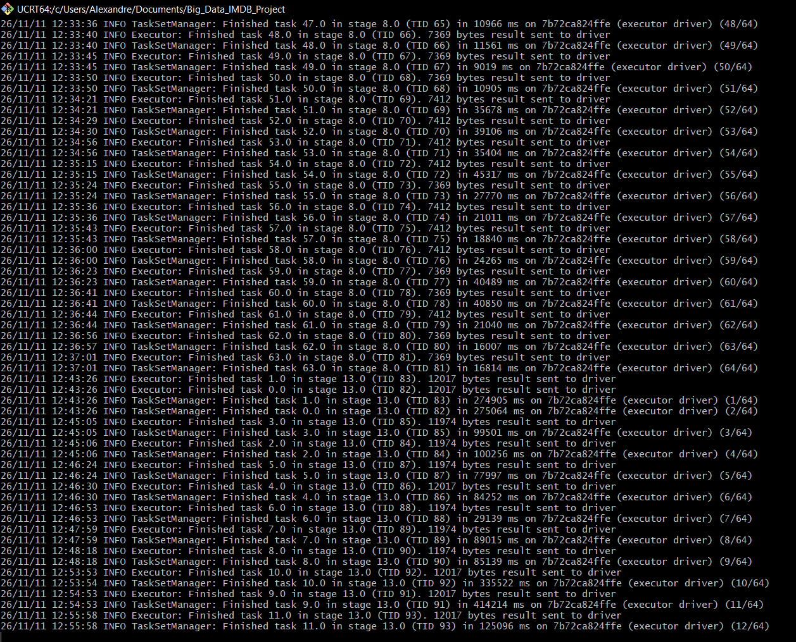

# IMDb Big Data Processing Report

## 1. Data Preparation

### 1.1 Null and Missing Values per Column

| Table | Column | Total rows | Null | Empty | Missing % |
|---|---|---|---|---|---|
| name.basics | nconst | 15765984 | 0 | 0 | 0.0 |
| name.basics | primaryName | 15765984 | 87 | 0 | 0.0 |
| name.basics | birthYear | 15765984 | 15081377 | 0 | 95.66 |
| name.basics | deathYear | 15765984 | 15501152 | 0 | 98.32 |
| name.basics | primaryProfession | 15765984 | 3203725 | 0 | 20.32 |
| name.basics | knownForTitles | 15765984 | 1909359 | 0 | 12.11 |
| title.akas | titleId | 59949689 | 0 | 0 | 0.0 |
| title.akas | ordering | 59949689 | 0 | 0 | 0.0 |
| title.akas | title | 59949689 | 0 | 0 | 0.0 |
| title.akas | region | 59949689 | 12939076 | 0 | 21.58 |
| title.akas | language | 59949689 | 19549363 | 0 | 32.61 |
| title.akas | types | 59949689 | 40116604 | 0 | 66.92 |
| title.akas | attributes | 59949689 | 59633311 | 0 | 99.47 |
| title.akas | isOriginalTitle | 59949689 | 0 | 0 | 0.0 |
| title.basics | tconst | 12898691 | 0 | 0 | 0.0 |
| title.basics | titleType | 12898691 | 0 | 0 | 0.0 |
| title.basics | primaryTitle | 12898691 | 0 | 0 | 0.0 |
| title.basics | originalTitle | 12898691 | 0 | 0 | 0.0 |
| title.basics | isAdult | 12898691 | 0 | 0 | 0.0 |
| title.basics | startYear | 12898691 | 1487504 | 0 | 11.53 |
| title.basics | endYear | 12898691 | 12735133 | 0 | 98.73 |
| title.basics | runtimeMinutes | 12898691 | 8033359 | 0 | 62.28 |
| title.basics | genres | 12898691 | 547433 | 0 | 4.24 |
| title.crew | tconst | 12898691 | 0 | 0 | 0.0 |
| title.crew | directors | 12898691 | 5746998 | 0 | 44.55 |
| title.crew | writers | 12898691 | 6387208 | 0 | 49.52 |
| title.episode | tconst | 9978123 | 0 | 0 | 0.0 |
| title.episode | parentTconst | 9978123 | 0 | 0 | 0.0 |
| title.episode | seasonNumber | 9978123 | 2096402 | 0 | 21.01 |
| title.episode | episodeNumber | 9978123 | 2096402 | 0 | 21.01 |
| title.principals | tconst | 102512651 | 0 | 0 | 0.0 |
| title.principals | ordering | 102512651 | 0 | 0 | 0.0 |
| title.principals | nconst | 102512651 | 0 | 0 | 0.0 |
| title.principals | category | 102512651 | 0 | 0 | 0.0 |
| title.principals | job | 102512651 | 82720617 | 0 | 80.69 |
| title.principals | characters | 102512651 | 52510212 | 0 | 51.22 |
| title.ratings | tconst | 1725891 | 0 | 0 | 0.0 |
| title.ratings | averageRating | 1725891 | 0 | 0 | 0.0 |
| title.ratings | numVotes | 1725891 | 0 | 0 | 0.0 |

We started to download the IMdB dataset with all files as title.ratings, title.principals, title.basics. We download the different files (.tsv.gz) on 26th October 2026 on the website datasets.imdbws.com where frequently IMDb updates them daily, so the figures depend on that date. The files contains 7 tables with 39 columns for a count approximately 215.7 million rows in total.

To obtain the result, we used the IMDb marker `\N` which is converted to null upon reading the file, a value is considered "empty" if it is an empty string or contains only spaces. To calculate the percentage, we used the formula Percentage = (nulls + empty values) / total number of rows × 100.

In the results, we got the percentage of nulls, missing, or empty records. We see that `empty_count` is 0 everywhere because IMDb never uses empty strings, only `\N`. The columns (`tconst`, `nconst`, `titleId`, `ordering`) have a 0% null rate, however, this does not guarantee that they point to existing rows this will be verified in step 1.3. Also, some columns are always populated: `titleType`, `primaryTitle`, `originalTitle`, `isAdult`, `category`, and `isOriginalTitle`.

The table `title.ratings` has a 0% null rate, simply because the file only contains titles that have been rated. The "missing ratings" are evident elsewhere: only 1.73 million titles are rated out of 12.9 million (approximately 13%). The column `primaryName` contains 87 null values, representing individuals without a name. While this is a very small number, it is nonetheless surprising.

Certain columns will have a direct impact on the exploration phase as `runtimeMinutes` (62.28%) for question 2.1, regarding film durations, `startYear` (11.53%) for questions involving years (2.2 and 2.3), `directors` (44.55%) for question 2.4, regarding directors, `genres` (4.24%) for all questions involving genres.

Finally `seasonNumber` and `episodeNumber` have the exact same number of null values ​​(2,096,402). These likely correspond to the same episodes that lack both a season number and an episode number.

`characters` has a null rate of 51.22%: individuals who are not actors (such as directors, composers, etc.) do not have an associated character.

### 1.2 Top Five Columns with the Highest Null Percentage

| Rank | Table | Column | Null % |
|---|---|---|---|
| 1 | title.akas | attributes | 99.47 |
| 2 | title.basics | endYear | 98.73 |
| 3 | name.basics | deathYear | 98.32 |
| 4 | name.basics | birthYear | 95.66 |
| 5 | title.principals | job | 80.69 |

To get the five columns across the entire dataset that have the highest percentage of null values, we needed to understand the question well because it refers exclusively to null values, but since `empty_count` is 0 throughout, the ranking is the same as it would be for missing values.

Then the core idea, is that these nulls do not all carry the same meaning where some represent unknown data, while others correspond to information that is simply not applicable to a given row. 

- The column `attributes` is an optional label for an alternative title (“literal title,” “working title,” etc.), which applies only in rare cases.

- The column `endYear` this one, only concerns series (tvSeries, tvMiniSeries). It is meaningless for a film, and it does not yet exist for an ongoing series. 

- The column `deathYear` which is left blank for living individuals, but also when the date is unknown—and there is no way to distinguish between the two cases.

- The column `birthYear` for this instance, it is a genuine case of missing data, as most of the individuals listed are lesser-known crew members. 

- The column `job` which is a free-text specification of a role, which is often redundant with the `category` field.

Looking ahead to question 1.4, this distinction will guide our processing strategy. An absent `endYear` for a film is not treated the same way as an unknown `birthYear`.

### 1.3 Other Data Quality Issues

After we obtained the different null and missing values, in this step we searched the other issues such as people who died before they were born, foreign keys with missing parent records or some others.
For this, we got 27 checks across the 7 tables, grouped into 5 categories: impossible values, consistency between columns, non-existent references, list formatting, and duplicates. These data correspond to the "unfinished" Parquet tables located in `data/parquet` where all these columns are just text (type string) in Parquet files. We made a Python script `data_quality.py` located in `src/preparation/` with the 27 checks.

- Impossible Values: death before birth, "living" person over 120 years old, future year, duration ≤ 0, season or episode ≤ 0, rating outside the 1–10 range, votes ≤ 0, isAdult value other than 0 or 1.

- Consistency between columns: endYear precedes startYear; endYear appears for a title that is not a series.

- Referential integrity: identifiers that point to a non-existent row, identified using `left_anti` joins (retaining rows from the "child" table that have no corresponding match in the "parent" table).

- List format: comma-separated lists are split using `explode`, and then each element is validated against a regular expression (tt…, nm…, or a genre starting with an uppercase letter).

- Duplicates: use `groupBy` on the key, then keep the keys that have more than one occurrence.

In the script, we converted the numbers with `try_cast` which returns null if the value is not a number, instead of causing Spark 4 to crash. In output, we got the values located in the CSV file `data_quality.csv` where for each check, it includes the number of rows verified, the number of issues found, the percentage, and three example identifiers. The file is written line by line, which allows the script to resume from where it left off in the event of a crash—something we experienced due to memory issues.

Results: 

For the first results, out of 27 checks, only 11 identified issues, while the remaining 16 found none (no duplicates, no invalid formats, no inconsistencies between endYear and startYear, and no invalid ratings).

The primary issues relate to references to non-existent individuals or titles, as well as values that are suspicious yet plausible (e.g., future release dates, "season 0," or individuals of an advanced age). All percentages are below 0.1%.

We got in output the different rows checked: 

| Check | Table | Rows checked | Issues | Issues % |
|---|---|---|---|---|
| Principal with an unknown person | title.principals | 102512651 | 7403 | 0.0072 |
| Season or episode number <= 0 | title.episode | 9978123 | 7108 | 0.0712 |
| Start year in the future | title.basics | 12898691 | 5180 | 0.0402 |
| Alive person older than 120 years | name.basics | 15765984 | 2796 | 0.0177 |
| Writer with an unknown person | title.crew | 15201667 | 1146 | 0.0075 |
| Director with an unknown person | title.crew | 9568274 | 419 | 0.0044 |
| Principal on an unknown title | title.principals | 102512651 | 206 | 0.0002 |
| Death year before birth year | name.basics | 15765984 | 27 | 0.0002 |
| Known-for title that does not exist | name.basics | 25513329 | 10 | < 0.0001 |
| Episode with an unknown parent series | title.episode | 9978123 | 5 | 0.0001 |
| Runtime not numeric or <= 0 | title.basics | 12898691 | 4 | < 0.0001 |

For example, for the Check "Director with an unknown person", "Write" or "Known-for", the count refers to the items in the lists, not the rows in the table, since a single row may mention multiple people or multiple titles.

Based on the table, we can understand that there are actual errors and potential errors because for the first case, we have for example 27 deaths occurring before birth, 4 durations ≤ 0, and broken references (7,403, 1,146, 419, 206, 10, 5—these 5 episodes all originate from the series tt28606619). Indeed, for this the cause is probably about the broken references where IMDb files are exported separately.

For the 2nd case, we got only 5,180 upcoming titles (announcements), 7,108 seasons or episodes numeroted of 0 (special episodes and pilots), 2,796 individuals over 120 years old with no recorded death (death date not provided) which linked with the case deathYear we observed in the question 1.2. 

### 1.4 Handling Strategy

For this part, after found and observed the different issues on the Parquet tables, we used another Python script `clean_data.py` located in `src/preparation` will reads Parquet tables located `data/parquet` to write cleaned tables in Parquet in the path `data/processed`. There are three possible actions as "deleted", "correct" (set to null), or mark (add a Boolean column) to got the final results.
The issues value in this table shows, the treatment chosen for each problem: 

| Issue (1.3) | Count | Handling | Action |
|---|---|---|---|
| Principal with an unknown person | 7403 | rows removed | remove |
| Principal on an unknown title | 206 | rows removed | remove |
| Episode with an unknown parent series | 5 | rows removed | remove |
| Runtime <= 0 | 4 | `runtimeMinutes` set to null | correct |
| Death year before birth year | 27 | both years set to null, `has_invalid_life_dates = true` | correct and flag |
| Start year in the future | 5180 | kept, `is_upcoming = true` | flag |
| Alive person older than 120 years | 2796 | kept, `death_year_unknown = true` | flag |
| Season or episode number <= 0 | 7108 | kept (specials and pilots) | none |
| Director / writer with an unknown person | 419 / 1146 | kept in the lists, dropped by inner joins later | none |
| Known-for title that does not exist | 10 | kept in the list, dropped by inner joins later | none |
| Not applicable nulls (e.g. `endYear` of a movie) | - | kept | none |

At the output, for example years, duration, ordering, and votes become integers, the rating becomes a decimal number. the variable isAdult and isOriginalTitle become booleans or genres, primaryProfession, knownForTitles, directors, and writers become arrays (split by comma).

After this, in output, the script cleans the values and the CSV file contains only the number of rows before and after for each table `cleaning_summary.csv` in `results/preparation`. 
We got the new table with the comparison of the number of rows before and after cleaning:

| Table | Rows before | Rows after | Rows removed |
|---|---|---|---|
| name.basics | 15765984 | 15765984 | 0 |
| title.basics | 12898691 | 12898691 | 0 |
| title.ratings | 1725891 | 1725891 | 0 |
| title.episode | 9978123 | 9978118 | 5 |
| title.principals | 102512651 | 102505042 | 7609 |
| title.crew | 12898691 | 12898691 | 0 |
| title.akas | 59949689 | 59949689 | 0 |

In the table, we got at the column Rows removed 7609, the result from 7403 + 206 which corresponds to the numbers got in the previous question (1.3) with no row contained both an unknown person and an unknown title. The 5 deleted episodes belong to the unknown series tt28606619, only 2 out of 7 tables lost any rows, and in each case, it was less than 0.01% of their total rows. Finally, we have the other issues were either corrected or flagged without deleting any rows.

### Methodological Explanation

For the question 1.1 to the part 2 (Data Exploration), to ingest the different values on the tables, the Python script `ingest_raw.py` located in `src/preparation/` reads the 7 `.tsv.gz` files using Spark (sep="\t", nullValue="\N", quote="") and writes them out once in Parquet format to `data/parquet` where the number of rows is verified after the write operation and also tables that already have a `_SUCCESS` marker are skipped if the script is run again. We used this method because as we know Parquet is columnar and compressed, where a script that reads only 2 columns does not read the entire file, and subsequent reads are much faster than with compressed TSV (since gzip files cannot be split, Spark processes each file using a single task).
As alternative solution, we also could reread the TSV for every script which is simple but it changes the process time.

To the question 1.2, we used the Python script from the path `src/preparation/null_analysis.py` which reads the Parquet tables from `data/parquet`, where for each table we have just one aggregation which calculate, for all columns simultaneously firstly the number of nulls (isNull)—that is, the `\N` values ​​converted during ingestion and secondly the number of empty or whitespace-only strings (`trim(column) == ""`). We obtain in output the file `missing_values.csv` from `results/preparation`. 
We used this method because we want to have a single pass per table—7 passes in total for the 39 columns, With tables containing over 100 million rows and each pass is costly. Counting empty strings also makes it possible to verify that IMDb uses only `\N` for missing values, rather than simply assuming so. The result `empty_count = 0` confirms this. The other advantage is that at the question 1.2 we do not trigguer any new Spark computations because it reuses just the result from the previous question.
For this as alternative solution, we could use just a request per column which is moresimple to write and read but with 39 readings contrary to 7 is much slower.

For the question 1.3, we chose the method explained previously such as `left_anti` join for broken references because this is a direct way to keep only those rows that have no corresponding match in the other table. We used the Spark function `try_cast` because we wanted to check that if a value is not a number, it becomes `null` instead of causing the job to fail—which, in fact, makes it possible to count such instances. For the Spark treatment, we got a line entry written after each check because Spark crashed due to the fact that the computer only has 8 GB of RAM, which is not enough for these volumes. This ensures that only the current check is lost, and the script can resume from where it left off. 
Alternatively, we could used a standard join followed by a function`isNull` which filter yields the same result as a `left_anti` join, but it retains the columns from both tables and consumes more memory.

For the question 1.4, we used `left_semi` via the method `.join` to retain only those rows where the title or the person exists, also `when`to set impossible values ​​to `null`, adding new Boolean columns as markers and writing each table as soon as it is ready, accompanied by a `_SUCCESS` marker. 

We used this method to handle different things because we want to remove only what would break the joins, we keep plausible values ​​because they are real and the flagging columns allow each question in Part 2 (Data Exploration) to decide whether or not to filter. Alternatively, we also could have chosen not to perform any cleaning or filtering within each script but the same task would be repeated everywhere, with a risk of something being overlooked.

## 2. Data Exploration

### 2.1 Feature-Length Movies with Atypical Runtime per Genre

### 2.2 Top Three Genres per Year (1980-2025)

### 2.3 Top Three Genres Compared to the Others

### 2.4 Directors with One Hit and Several Low-Rated Movies

### 2.5 TV Series with Worst Episode in the Last Season

### 2.6 Actors Successful in Multiple Languages

### 2.7 Actors Whose Popularity Peaked Early

### 2.8 Multi-Talented Professionals

### Methodological Explanation

## 3. Data Enrichment

### Results

### Methodological Explanation

## 4. Streaming

### Streaming Metrics

Test run: 10 November 2026, 16:33 to 17:03 UTC (30 minutes), on an 8 GB
laptop. Window: 5 minutes, watermark: 2 minutes, trigger: 30 seconds.
Full output: `results/streaming/summary.md`.

| Metric | Value |
|---|---|
| Events read from Kafka | 60 970 |
| Events in closed windows | 53 991 |
| English Wikipedia article edits (closed windows) | 2 360 |
| Edits matched with IMDb | 137 |
| Matched on a title / on a person | 90 / 47 |
| Distinct IMDb entities | 94 |
| IMDb lookup table | 58 542 titles, 226 714 people |

| Query | Batches | Input rows | Avg inputRowsPerSecond | Avg processedRowsPerSecond | Rows dropped by watermark |
|---|---|---|---|---|---|
| matched_events | 61 | 60 970 | 33.7 | 303.2 | 0 |
| title_windows | 61 | 60 970 | 33.8 | 273.8 | 0 |
| stream_windows | 61 | 60 955 | 33.8 | 313.3 | 0 |

Arrival delay of the matched edits (Kafka time minus edit time):

| Median | p95 | p99 | Max | Edits later than 2 min |
|---|---|---|---|---|
| 3 s | 9 s | 15 s | 20 s | 0 |

Top 10 most edited IMDb entities:

| IMDb id | Type | Label | Edits | Editors |
|---|---|---|---|---|
| nm0909144 | person | David Walliams | 6 | 3 |
| tt0054545 | title | Hazel | 4 | 1 |
| tt0388629 | title | One Piece | 4 | 3 |
| tt0070842 | title | Turkish Delight | 4 | 1 |
| nm2908492 | person | Grant Harvey | 3 | 1 |
| nm0001001 | person | James Caan | 3 | 2 |
| tt32641461 | title | Mid-Century Modern | 3 | 2 |
| nm1104787 | person | Mutya Buena | 3 | 2 |
| tt0162866 | title | The Emperor and the Assassin | 3 | 1 |
| tt0113613 | title | The Last Supper | 3 | 1 |

### Late Arriving Data

### Methodological Explanation

## 5. Open Question

### Question and Motivation

### Results

### Key Takeaways

### Methodological Explanation